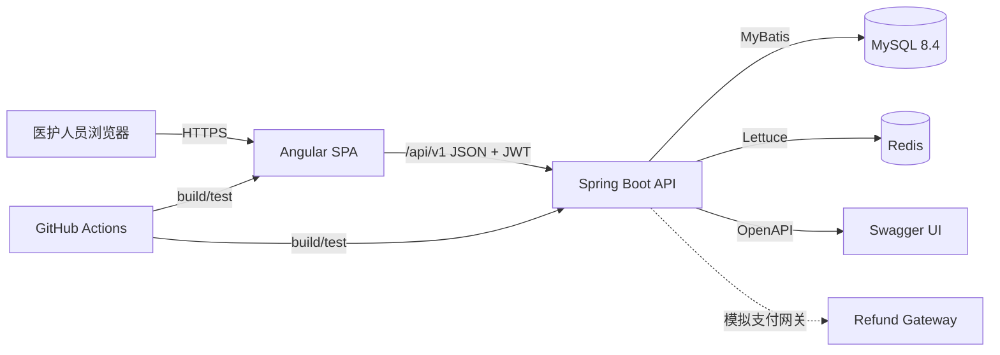
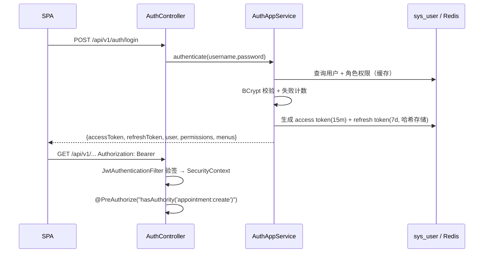

# MedFlow 架构设计

| 项 | 值 |
| --- | --- |
| 版本 | v1.0（第一阶段） |
| 形态 | 前后端分离单体（Modular Monolith）+ 单库 |
| 前端 | Angular 22.2（standalone / signals / zoneless） |
| 后端 | Java 21 + Spring Boot 4.1.2（Spring Framework 7 / Security 7） |
| 数据 | MySQL 8.4 LTS + Redis 8 |
| 部署 | Docker Compose（本地/演示），GitHub Actions（CI） |

## 1. 架构目标与取舍

**目标**：用最少的运行组件，表达真实门诊系统的全部关键难点——并发、状态机、幂等、审计、数据隔离、库存一致性。架构必须让这些规则**有地方可放、有测试可证**。

**取舍**：

| 决策 | 选择 | 放弃 | 理由 |
| --- | --- | --- | --- |
| 服务拆分 | 模块化单体 | 微服务 | 单库本地事务足以保证库存/处方一致性，避免分布式事务与运维噪声 |
| 前端渲染 | SPA（CSR） | SSR | 内部系统，无 SEO 需求；SSR 会增加鉴权与部署复杂度 |
| 状态管理 | Signals + 轻量 Store | NgRx | 团队规模与状态复杂度不需要全局 store；Signals 足够且更贴近模板 |
| 表单 | Signal Forms + Reactive Forms 混用 | 单一方案 | 静态表单用 Signal Forms；运行时 Schema 生成的病历表单用 Reactive Forms |
| ORM | MyBatis-Plus + 手写 SQL | 全 JPA | 关键并发路径需要精确控制 SQL；MP 负责常规 CRUD 与分页 |
| 权限 | RBAC + 数据范围 | ABAC/策略引擎 | 五角色、科室隔离用 RBAC 足够，策略引擎是过度设计 |
| 缓存 | Redis 缓存/草稿/会话 | 分布式锁 | 正确性由数据库条件更新保证；锁会掩盖设计问题 |
| 事件 | 本地事务 + 事务性发件箱（按需） | MQ | 无跨服务调用；外部副作用（退款）用重试队列 |

## 2. 系统上下文



运行组件：`web`（静态资源，开发期为 `ng serve`）、`api`、`mysql`、`redis`。无消息队列、无服务发现、无独立网关。

## 3. 技术选型与兼容性验证

### 3.1 锁定版本

| 组件 | 版本 | 选择依据 |
| --- | --- | --- |
| Angular | **22.2.3**（core / CLI / build / Material / CDK 全量统一） | `@angular/compiler-cli` 最新为 22.2.3，CLI 22.2.4 无对应 compiler-cli，统一 22.2.3 避免补丁错配 |
| TypeScript | **6.0.2** | Angular 22 `compiler-cli` peer 要求 `>=6.0 <6.1`，**不能使用 TS 7** |
| RxJS | **7.8.x** | Angular 22 peer `^7.4.0` |
| Angular Material / CDK | **22.2.3** | 与 Angular 22.2.3 同版本线；M3 主题 |
| Vitest | **5.0.5** | Angular 22 `@angular/build:unit-test` 默认测试器 |
| jsdom | **30.x** | CLI 22 默认 DOM 环境 |
| Node.js | **24.18.0** | Angular 22 engines：`^22.22.3 \|\| ^24.15.0 \|\| >=26` |
| pnpm | **12.11.2** | 工作区与锁文件 |
| angular-eslint | **22.6.0** | 支持 ESLint 10 / TS 6 |
| ESLint / Prettier | **10.13.0 / 3.9.10** | angular-eslint peer 允许 ESLint 10 |
| Java | **21.0.12 (LTS)** | Boot 4 基线 17，团队统一 21 |
| Spring Boot | **4.1.2** | Initializr 当前默认稳定版（4.2 仍为 RC） |
| Spring Framework / Security | **7.0.10 / 7.1.2** | Boot 4.1.2 BOM 管理 |
| MyBatis-Plus | **3.5.18**（`mybatis-plus-spring-boot4-starter`） | 官方 Boot 4 starter，POM 基于 Boot 4.1.0 + mybatis-spring 4.1.0 |
| Flyway | **12.4.0** | Boot BOM 管理，需额外 `flyway-mysql` |
| springdoc-openapi | **3.1.0** | Initializr 为 Boot 4.1.2 选择的版本（3.2.0 已发布，升级需回归） |
| MySQL | **8.4 LTS** | 长期支持，JSON/生成列/CHECK 均满足 |
| Redis | **8.x** | 缓存、会话、草稿；用 7.x 兼容命令 |
| Testcontainers | **2.x**（Boot BOM） | 集成测试使用真实 MySQL/Redis |

### 3.2 已执行的兼容性验证（2026-10-26）

| # | 验证 | 命令/方法 | 结果 |
| --- | --- | --- | --- |
| 1 | Angular 版本与 TS 范围 | `npm view @angular/compiler-cli@22.2.3 peerDependencies` | `typescript >=6.0 <6.1` → 锁 TS 6.0.2 |
| 2 | Node 引擎 | `npm view @angular/core@22.2.3 engines` | `^22.22.3 \|\| ^24.15.0 \|\| >=26`，本机 24.18.0 通过 |
| 3 | Angular 22 默认工程 | `ng new probe`（CLI 22.2.4 生成，最终锁定 22.2.3） | zoneless（无 zone.js）、Vitest 5 + jsdom、`@angular/build:unit-test` |
| 4 | Signal Forms 可用性 | 检查 `@angular/forms/signals` 类型 | `@publicApi 22.0`，`form/required/applyWhen/applyEach` 等已公开 |
| 5 | Signal Forms × Material | `mat-form-field + input[formField]` 冒烟测试 | 编译、渲染、校验均通过 |
| 6 | Boot 4.1.2 工程 | Spring Initializr 4.1.2.RELEASE 生成 | 默认使用 `spring-boot-starter-webmvc`、`spring-boot-starter-flyway`、`*-test` 分拆 starter |
| 7 | MyBatis-Plus × Boot 4 | 生成工程加入 MP boot4 starter 后 `mvn compile` | 通过；解析到 mybatis-spring 4.1.0、mybatis 3.5.19 |
| 8 | 官方 MyBatis starter | Initializr 校验 | 明确提示 **不兼容 Boot 4.1.2** → 使用 MyBatis-Plus 官方 starter |
| 9 | Jackson 版本 | `mvn dependency:tree` | Boot 4 使用 Jackson 3.1.7（`tools.jackson`）；springdoc 3.1.0 自带 Jackson 2.21，二者共存 |
| 10 | springdoc | Initializr + Maven Central | 3.1.0 为 Boot 4.1.2 的默认组合 |
| 11 | Docker 运行时 | `docker info` | Colima 29.5.2 / Ubuntu 24.04，可运行 Compose |

**结论**：Angular 22 + TS 6 + Vitest 5 + Material 22 + Signal Forms 组合可用；Boot 4.1.2 + Security 7 + MyBatis-Plus 3.5.18 + Flyway 12 + springdoc 3.1.0 组合可用。所有版本在 `package.json` / `pom.xml` 中**精确锁定**（不使用 `^`/`~` 浮动）。

### 3.3 Boot 4 迁移注意点（已纳入编码规范）

| 变化 | 旧写法 | 新写法 |
| --- | --- | --- |
| Web starter | `spring-boot-starter-web` | `spring-boot-starter-webmvc` |
| 测试 starter | `spring-boot-starter-test` 一把梭 | 按模块 `spring-boot-starter-webmvc-test`、`-security-test` 等 |
| Flyway | `flyway-core` 手写 | `spring-boot-starter-flyway` + `flyway-mysql` |
| JSON | `com.fasterxml.jackson.*` | `tools.jackson.*`（Jackson 3）；仅第三方（springdoc）内部仍用 Jackson 2 |
| Security | 已弃用的链式方法 | Lambda DSL；`authorizeHttpRequests`、`requestMatchers` |
| Testcontainers | `org.testcontainers:mysql` | `org.testcontainers:testcontainers-mysql`，JUnit 集成用 `testcontainers-junit-jupiter` |
| AOP | `spring-boot-starter-aop` | `spring-boot-starter-aspectj` |

## 4. 后端架构

### 4.1 分层与依赖规则

```text
api (Controller / DTO / Assembler)
        │ 只能向下
        ▼
application (用例编排 / 事务边界 / 幂等 / 审计)
        │
        ▼
domain (聚合 / 状态机 / 领域策略 / 仓储端口)
        ▲
        │ 实现端口
infrastructure (MyBatis Mapper / PO / Repository 实现 / Redis / 外部网关)
```

| 层 | 职责 | 禁止 |
| --- | --- | --- |
| `api` | HTTP 协议、参数校验、DTO 映射、权限注解 | 写业务规则、直接调 Mapper |
| `application` | 用例事务、编排领域对象与端口、记录审计、发布事件 | 出现 SQL/HTTP 细节 |
| `domain` | 状态迁移、不变量、业务校验、值对象 | 依赖 Spring Web/MyBatis/Redis |
| `infrastructure` | 持久化、缓存、外部接口实现 | 包含业务判断 |

由 ArchUnit 在测试中强制：`domain` 不得依赖 `org.springframework.web`、`com.baomidou`、`infrastructure`；`api` 不得依赖 `infrastructure`；`@RestController` 不得注入 Mapper。

### 4.2 包结构（按业务领域，领域内分层）

```text
com.medflow
├── MedflowApplication.java
├── common
│   ├── config         MybatisPlusConfig / RedisConfig / OpenApiConfig / WebConfig
│   ├── error          ErrorCode / BusinessException / GlobalExceptionHandler
│   ├── security       SecurityConfig / JwtService / JwtAuthenticationFilter / CurrentUser / DataScopeResolver
│   ├── audit          AuditRecorder / AuditEvent / AuditAction
│   ├── idempotency    IdempotencyService / IdempotencyKey
│   └── persistence    BaseEntity / MetaObjectHandler / PageQuery
├── auth               login / refresh / logout / me
├── iam                user / role / permission / department
├── patient
├── appointment        schedule / slot / appointment / charge / refund
├── encounter
├── emr                template / record / version / dynamic-form
├── prescription
├── pharmacy           drug / batch / stock / dispense / return
└── system             health / meta
```

单模块内每个领域：

```text
appointment/
├── api/            AppointmentController, dto/
├── application/    AppointmentAppService, command/, query/
├── domain/         Appointment, SlotBookingPolicy, AppointmentStatus, AppointmentRepository(port)
└── infrastructure/ AppointmentMapper, AppointmentPO, AppointmentRepositoryImpl
```

### 4.3 领域模型与状态机

- 状态机在领域层用 `enum` + 显式迁移表实现，例如 `AppointmentStatus.canTransitionTo(target, action)`；应用服务只调用领域方法，不直接 `setStatus`。
- 状态变更统一走 `Aggregate.apply(action)`，返回 `List<DomainEvent>`，由应用服务转换为审计与流水。
- 不变量在构造函数/工厂中校验（如号源余量、处方明细至少一条、病历版本号连续）。
- 值对象：`Money`、`DateRange`、`Dosage`、`IdempotencyKey`、`ContentHash`。
- 领域异常：`BusinessException(ErrorCode, args)`，由全局处理器映射为 ProblemDetail。

### 4.4 事务、幂等、审计

```text
ApplicationService.method(cmd):
  @Transactional
  1. authorize(resource, action)            # 数据范围 + 归属校验
  2. idempotency.guard(key, hash)          # 预留/回放
  3. load aggregate → domain.apply(action) # 状态机
  4. repository.save(aggregate)            # 条件更新/乐观锁
  5. audit.record(event)                   # 同事务
  6. idempotency.complete(response)        # 同事务
```

- 事务只包住应用服务方法；控制器不做事务。
- 读接口 `@Transactional(readOnly = true)`，禁止在只读事务中写审计。
- 审计由应用服务显式调用（而非 AOP），因为审计需要业务上下文（修订号、原因、余额），AOP 只能拿到参数。
- 事务性发件箱仅用于外部副作用（退款、通知），不参与核心一致性。

### 4.5 持久化策略

| 场景 | 方案 |
| --- | --- |
| 常规分页/单表查询 | MyBatis-Plus `BaseMapper` + `LambdaQueryWrapper` |
| 状态迁移/号源扣减/库存扣减 | 手写 XML：`UPDATE ... WHERE id=? AND status=? AND version=?`，判断受影响行数 |
| 多表列表/报表 | 手写 SQL + DTO 映射 |
| 乐观锁 | MP `OptimisticLockerInnerInterceptor` + `@Version`；关键路径显式带 `version` |
| 分页 | MP 分页插件，上限 100 条 |
| 自动填充 | `MetaObjectHandler` 填充 `createdBy/updatedBy/createdAt/updatedAt` |

**禁止**：在状态迁移中使用 `updateById`（会绕过状态条件）；在循环中逐条查询（N+1）。

### 4.6 安全架构



- 访问令牌：JWT HS256（Nimbus `JwtEncoder`），claims：`sub`（用户 ID）、`username`、`deptId`、`roles`、`jti`、`exp`；15 分钟。权限不在令牌里，每次请求从 Redis/数据库加载，角色变更可即时生效。
- 刷新令牌：随机 256bit，Redis 存 `SHA-256(token)` → `userId|sessionId|ACTIVE`，TTL 7 天；Lua 原子轮换为 `ROTATED`，检测重放即吊销当前会话。
- 登出：`jti` 加入 Redis 拒绝名单（TTL = 剩余有效期）并删除刷新令牌。
- 权限缓存：`perm:user:{id}`（AuthoritySnapshot JSON，TTL 10 分钟）；角色授权、用户角色/状态/资料变更时主动失效。
- 登录失败：数据库 `failed_attempts` / `locked_until` 计数，5 次 / 15 分钟锁定；锁定状态写入 `sys_user.status='LOCKED'`，由管理员启用或到期自动解除。
- 密码：BCrypt cost 12；禁止返回密码哈希；重置密码后吊销该用户全部刷新令牌。
- 越权审计：方法级 403 由全局异常处理器记录 `ACCESS_DENIED`（用户、路径、错误码），失败审计使用独立事务提交。
- CORS：开发期允许 `http://localhost:4200`；生产同源反向代理。
- CSRF：Bearer Token + 无 Cookie 会话，关闭 CSRF；CSP 由 Nginx 配置。

### 4.7 错误与响应

- 成功：`200/201/204` + 资源 DTO；列表 `{items, page, size, total}`。
- 失败：RFC 9457 `application/problem+json`：

```json
{
  "type": "https://medflow.local/problems/MED-STOCK-001",
  "title": "库存不足",
  "status": 409,
  "detail": "阿莫西林胶囊 可用量 3，申请 10",
  "instance": "/api/v1/prescriptions/102/review",
  "code": "MED-STOCK-001",
  "requestId": "01J...",
  "fieldErrors": [],
  "conflict": { "available": 3, "drugId": 8 }
}
```

- 全局异常映射：`BusinessException`、`MethodArgumentNotValidException`、`AccessDeniedException`、`ObjectOptimisticLockingFailureException`、`DuplicateKeyException`、兜底 500（隐藏堆栈，记录 traceId）。
- 每个响应带 `X-Request-Id`；日志 MDC 注入，便于串联。

### 4.8 API 约定

| 项 | 约定 |
| --- | --- |
| 前缀 | `/api/v1` |
| 资源 | 复数名词：`/appointments`、`/prescriptions` |
| 动作 | 子资源：`POST /appointments/{id}/cancel`、`POST /prescriptions/{id}/review` |
| 分页 | `?page=1&size=20&sort=createdAt,desc`，`size<=100` |
| 日期 | `yyyy-MM-dd`；时间 ISO-8601 带时区 |
| 幂等 | 写接口 `Idempotency-Key` header（UUID） |
| 并发 | 请求体携带 `version`；冲突返回 409 + 最新资源 |
| 鉴权 | `Authorization: Bearer <jwt>` |
| 文档 | springdoc `/v3/api-docs`、`/swagger-ui.html`，CI 导出 `docs/openapi.json` |

### 4.9 可观测性

- Actuator：`/actuator/health`（公开，仅总体状态）、`/actuator/info`、`/actuator/metrics`（仅管理员）。
- 健康检查分组：`db`、`redis` 就绪探针。
- 结构化日志（prod profile）：`logging.structured.format.console=ecs`，字段含 `traceId`、`userId`、`path`。
- 慢 SQL：MyBatis 拦截器记录 > 500ms 语句（不含参数值）。
- 审计与业务指标：预约成功率、平均候诊时长、处方驳回率（M6 后加 Micrometer 指标）。

## 5. 前端架构

### 5.1 运行模式

- Angular 22 **zoneless**（CLI 默认），无 `zone.js`；所有异步更新依赖 signals 或显式 `markForCheck`。
- 全部组件 standalone，无 NgModule。
- 路由级懒加载，按业务域拆分 chunk。
- 严格 TS：`strict`、`noUncheckedIndexedAccess`、`exactOptionalPropertyTypes`（在 CLI 默认基础上加强）。

### 5.2 目录结构

```text
frontend/src/app
├── app.ts / app.html / app.scss
├── app.config.ts                 # providers：router、http、material、locale
├── app.routes.ts                 # 顶层路由 + 懒加载 + 守卫
├── core
│   ├── auth        auth.store.ts, auth.service.ts, token.storage.ts, guards/
│   ├── http        api-base.ts, auth.interceptor.ts, error.interceptor.ts, problem-detail.ts
│   ├── permissions permission.store.ts, has-permission.directive.ts
│   ├── config      app-config.ts, environment.ts
│   └── ui          layout/, page-header/, empty-state/, confirm-dialog/
├── shared
│   ├── ui          status-chip/, paginator/, search-input/
│   ├── pipes       date-time.pipe.ts
│   └── utils       result.ts, date.ts
└── features
    ├── auth            login page + store
    ├── dashboard       overview cards, system status
    ├── patients        data/ state/ ui/ routes.ts
    ├── appointments    schedule/ booking/ queue/
    ├── encounters      workstation/ diagnosis/
    ├── emr             template/ editor/ history/ dynamic-form/
    ├── prescriptions   editor/ review/
    ├── pharmacy        stock/ dispense/ return/
    └── admin           users/ roles/ departments/ audit/
```

**规则**：

1. 组件不直接注入 `HttpClient`；通过 `data/*.api.ts`。
2. 组件不持有跨页面状态；状态放 `state/*.store.ts`（`providedIn: 'root'` 或路由级 provider）。
3. `shared/` 不含业务逻辑；`core/` 不含页面。
4. 每个 feature 导出 `routes.ts`，由顶层懒加载。

### 5.3 Signals 状态模式

```ts
@Injectable({ providedIn: 'root' })
export class AppointmentStore {
  private readonly api = inject(AppointmentApi);
  private readonly _slots = signal<Slot[]>([]);
  private readonly _loading = signal(false);
  private readonly _error = signal<ProblemDetail | null>(null);

  readonly slots = this._slots.asReadonly();
  readonly loading = this._loading.asReadonly();
  readonly error = this._error.asReadonly();
  readonly remaining = computed(() =>
    this._slots().reduce((sum, s) => sum + s.capacity - s.bookedCount, 0),
  );

  load(date: string): void {
    this._loading.set(true);
    this.api.findSlots({ date }).pipe(
      takeUntilDestroyed(this.destroyRef),
      finalize(() => this._loading.set(false)),
    ).subscribe({
      next: (slots) => this._slots.set(slots),
      error: (e: ProblemDetail) => this._error.set(e),
    });
  }
}
```

约定：

| 用途 | 工具 |
| --- | --- |
| 同步派生状态 | `computed` |
| 异步数据流 | RxJS + `takeUntilDestroyed` |
| 副作用（持久化草稿、埋点） | `effect`，且必须显式声明依赖 |
| 表单 | Signal Forms（静态）/ Reactive Forms（动态 Schema） |
| 跨组件共享 | Store 注入，不通过 `@Input` 层层传递 |
| 服务端状态缓存 | Store 内 signals + 手动失效；不引入 TanStack Query |

**禁止**：在 `effect` 中发请求（容易循环）；在模板里调用非纯函数；用 `mutate` 直接改数组（用不可变更新）。

### 5.4 Signal Forms 兼容性评估与决策

| 评估项 | 结论 |
| --- | --- |
| API 状态 | Angular 22 已标记 `@publicApi 22.0`，`form()/required()/minLength()/applyWhen()/applyEach()` 可用 |
| 与 Material 集成 | `mat-form-field` + `input matInput [formField]` 冒烟通过（编译、渲染、必填校验） |
| 类型安全 | 模型类型推导到字段路径，优于 Reactive Forms 的 `AbstractControl` |
| 动态 Schema | **不适合**运行时任意增减字段（字段树在 `form()` 时确定） |
| 生态 | 部分第三方组件仍依赖 `ngModel`/`FormControl`，需要适配 |

**决策（ADR-002）**：

- 登录、患者建档、排班、处方开立等**字段集合在编译期已知**的表单 → Signal Forms。
- 电子病历模板由后台 Schema 运行时决定，字段数量/类型/联动不可预知 → 自研 `DynamicFormEngine`（基于 Reactive Forms `FormGroup/FormRecord` + 模板规则校验器），表单状态用 signals 包装。
- 不使用 `ngModel`；禁止混合两种表单模型于同一组件。

### 5.5 HTTP 与鉴权

- `authInterceptor`：附加 Bearer；遇到 401 且存在刷新令牌时，**单例刷新队列**（同一时刻只发一次刷新请求，其余请求等待），刷新失败跳登录。
- `errorInterceptor`：将 ProblemDetail 转为 `MedflowError`，`fieldErrors` 注入表单，`conflict` 触发冲突对话框。
- `authGuard` / `permissionGuard`：未登录跳 `/login?redirect=`；无权限跳 `/403`。
- `*appHasPermission` 结构型指令：无权限移除元素（而非 `hidden`）。
- 前端权限只用于体验，**后端始终重新校验**。

### 5.6 UI 与可用性

- Angular Material M3 主题：主色医疗蓝、辅助青绿；紧凑密度适配表格。
- 布局：顶栏（用户/科室/通知）+ 可折叠侧边菜单（按权限生成）+ 内容区。
- 状态展示用"颜色 + 图标 + 文本"，不只依赖颜色（色盲友好）。
- 表格：CDK virtual scroll（超过 100 行）、列排序、空态、加载骨架。
- 表单：字段级错误、保存状态（已保存/保存中/冲突）、离开未保存提示。
- 键盘可达：对话框焦点陷阱、Esc 关闭、跳过导航链接。
- 字号/对比度满足 WCAG AA 基础要求。

### 5.7 前端测试策略

| 层级 | 工具 | 覆盖 |
| --- | --- | --- |
| 纯函数/Pipe | Vitest | 日期、状态映射、权限判断 |
| Store | TestBed + `HttpTestingController` | 加载/错误/竞态取消 |
| 组件 | TestBed + jsdom | 渲染、交互、权限指令 |
| 动态表单引擎 | 单测 | 条件显示、校验、Schema 版本 |
| E2E（后续） | Playwright | 登录→预约→接诊→签署→发药主链路 |

Angular 22 无 zone，测试使用 `await fixture.whenStable()`；不引入 `fakeAsync` 新代码（zoneless 下优先 `await`）。

## 6. 运行时与部署

### 6.1 本地拓扑

| 服务 | 端口 | 说明 |
| --- | --- | --- |
| `web`（ng serve） | 4200 | `/api`、`/actuator` 代理到 8080 |
| `api` | 8080 | Spring Boot |
| `mysql` | 3307 → 3306 | 避免与本机 MySQL 冲突 |
| `redis` | 6379 | 缓存/会话/草稿 |
| Adminer（可选） | 8081 | 数据库可视化 |

### 6.2 配置

```yaml
# application.yml（节选）
spring:
  datasource:
    url: jdbc:mysql://${DB_HOST:localhost}:${DB_PORT:3307}/medflow?useUnicode=true&characterEncoding=utf8&serverTimezone=Asia/Shanghai&allowPublicKeyRetrieval=true&useSSL=false
  flyway:
    locations: classpath:db/migration
  data:
    redis:
      host: ${REDIS_HOST:localhost}
      port: ${REDIS_PORT:6379}
medflow:
  jwt:
    issuer: medflow
    access-token-ttl: 15m
    refresh-token-ttl: 7d
    secret: ${JWT_SECRET:}
```

- 敏感配置只来自环境变量；`local` profile 提供演示默认值并在启动日志警告。
- 生产必须设置 `JWT_SECRET`（≥ 32 字节），否则启动失败。
- Flyway 在 `local`/`test` 自动迁移；生产由发布流水线显式执行。

### 6.3 Docker Compose

- `mysql:8.4`：命名卷、utf8mb4、健康检查、初始化仅创建数据库。
- `redis:8-alpine`：AOF 持久化（`appendonly yes`），健康检查。
- `api` / `web` 以 `profiles: [app]` 提供完整一键启动；开发默认只起依赖。
- 所有服务使用 `restart: unless-stopped` 与 healthcheck 依赖顺序。

### 6.4 CI（GitHub Actions）

```text
job frontend: pnpm install --frozen-lockfile → lint → test --coverage → build
job backend : setup-java 21 + cache → ./mvnw -B verify（Testcontainers）
job smoke   : docker compose up -d → 等待健康 → curl 健康检查 → 登录/预约场景（M2+）
```

质量门禁：前端 lint 0 error、测试全绿、构建成功；后端测试全绿、JaCoCo 领域层覆盖率 ≥ 85%、ArchUnit 通过。

## 7. 架构决策记录（ADR）

### ADR-001：后端使用 Spring Boot 4.1 + MyBatis-Plus 3.5.18

- **背景**：Boot 3.5 已进入维护末段；Boot 4 是当前默认稳定版，但官方 MyBatis starter 尚不兼容。
- **决策**：采用 Boot 4.1.2 + MyBatis-Plus 官方 `mybatis-plus-spring-boot4-starter` 3.5.18。
- **代价**：Jackson 3 与 Security 7 需要按新 API 编写；升级 MP 需跟随 Boot BOM。
- **替代**：Boot 3.5.16 + MP boot3 starter（更保守，但技术栈落后一个主版本）。

### ADR-002：静态表单用 Signal Forms，动态病历表单用 Reactive Forms

- **背景**：Signal Forms 在 22 稳定，且与 Material 兼容；但字段树在构建期确定，无法表达运行时 Schema。
- **决策**：按表单来源分工；统一以 signals 暴露表单状态给页面。
- **代价**：两套表单 API，需要团队约定边界；通过目录与代码评审约束。
- **替代**：全部 Reactive Forms（失去类型安全与 Signal 集成）或全部 Signal Forms（无法支持动态模板）。

### ADR-003：模块化单体 + 单库，不引入 MQ

- **背景**：业务闭环内所有写操作需要强一致（号源→预约、处方→库存）。
- **决策**：单应用、单数据库、本地事务；跨模块只通过应用服务或同库事务协作。
- **代价**：无法独立扩缩容；模块边界靠包结构与 ArchUnit 守护。
- **替代**：微服务 + Saga（复杂度与演示价值不成正比）。

### ADR-004：正确性依赖数据库原子操作，Redis 不做锁

- **背景**：并发超卖、库存扣减是最容易出错的部分。
- **决策**：条件更新 + 唯一约束 + 乐观锁；Redis 仅用于权限缓存、刷新令牌、登出拒绝名单与后续的草稿。登录失败计数与锁定放在数据库，便于审计与管理端展示。
- **代价**：热点号源/批次会有行锁竞争（通过短事务和索引缓解）。
- **替代**：Redis 分布式锁（故障时正确性受损，且难以测试）。

### ADR-005：访问令牌 JWT + 刷新令牌轮换

- **背景**：需要无状态鉴权与可撤销会话。
- **决策**：15 分钟 JWT + 7 天 Redis 刷新令牌（一次性轮换、重放检测）。
- **代价**：登出后访问令牌在 15 分钟内仍可能有效（通过 `jti` 拒绝名单缩短窗口）。
- **替代**：纯 Session（横向扩展需共享存储，反正已有 Redis，但 JWT 更贴近现代 SPA）。

## 8. 已知风险与缓解

| 风险 | 影响 | 缓解 |
| --- | --- | --- |
| Boot 4 / Jackson 3 生态较新 | 第三方库不兼容 | 已验证核心依赖；第三方库升级前跑集成测试；避免引入 Jackson 2 插件 |
| MyBatis-Plus 新 starter 的边界行为 | 分页/乐观锁失效 | 关键路径手写 SQL；集成测试覆盖受影响行数 |
| Signal Forms 与 Material/CDK 边缘组件 | 表单控件异常 | 登录页使用 Signal Forms 并通过组件测试；后台多选场景使用原生控件 + 手动校验，保留 Reactive Forms 回退 |
| 动态病历 Schema 复杂度失控 | 表单引擎难维护 | 限制字段类型白名单；规则 DSL 只支持 `visibleWhen/requiredWhen/范围`；服务端统一校验 |
| 并发测试不稳定 | CI 偶发失败 | Testcontainers + 固定线程数 + 断言"成功数=容量"而非时序；重试仅用于基础设施 |
| 演示数据与真实数据混淆 | 合规风险 | 所有姓名/证件/电话为合成；页面顶部标注"演示数据"；禁止导入真实数据 |
