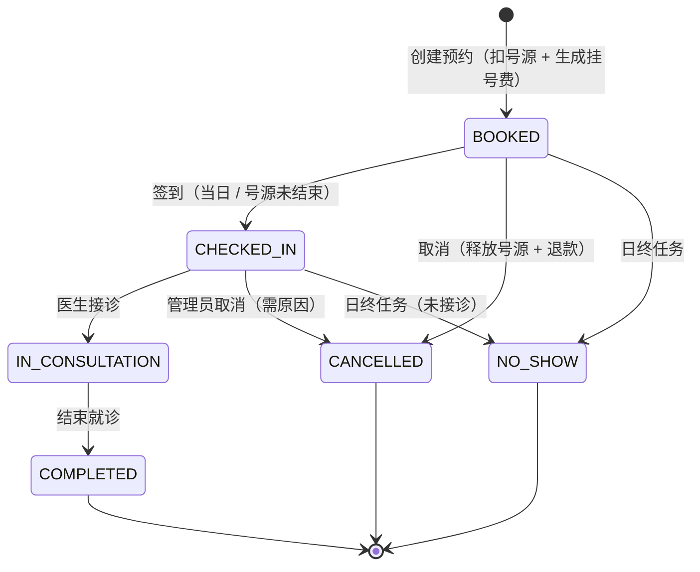
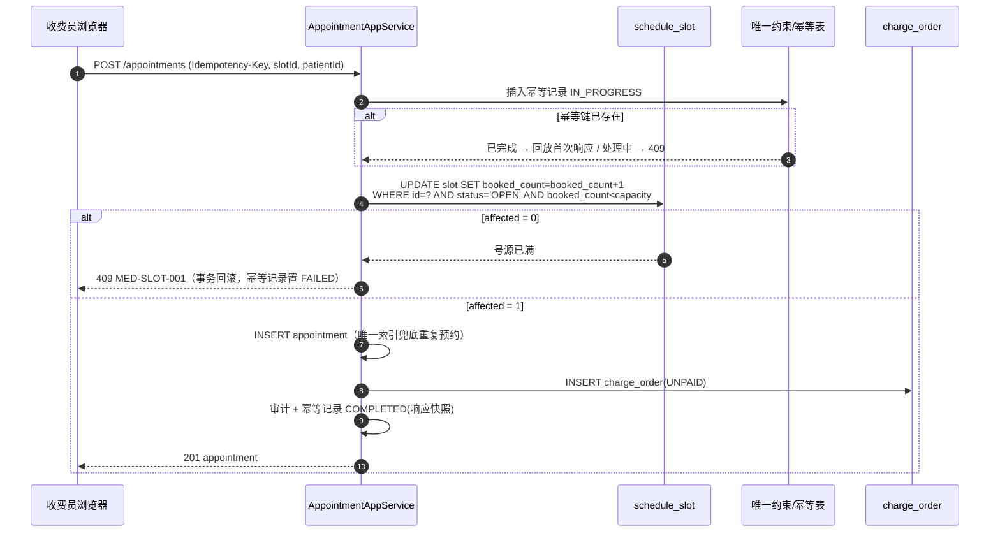
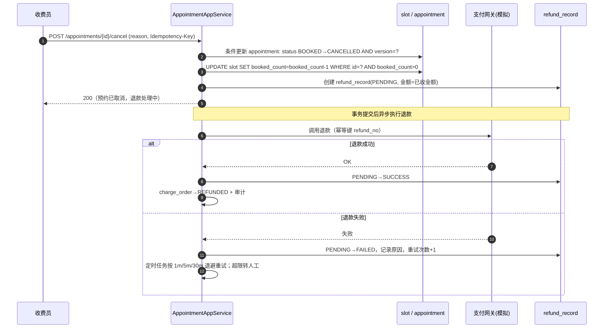
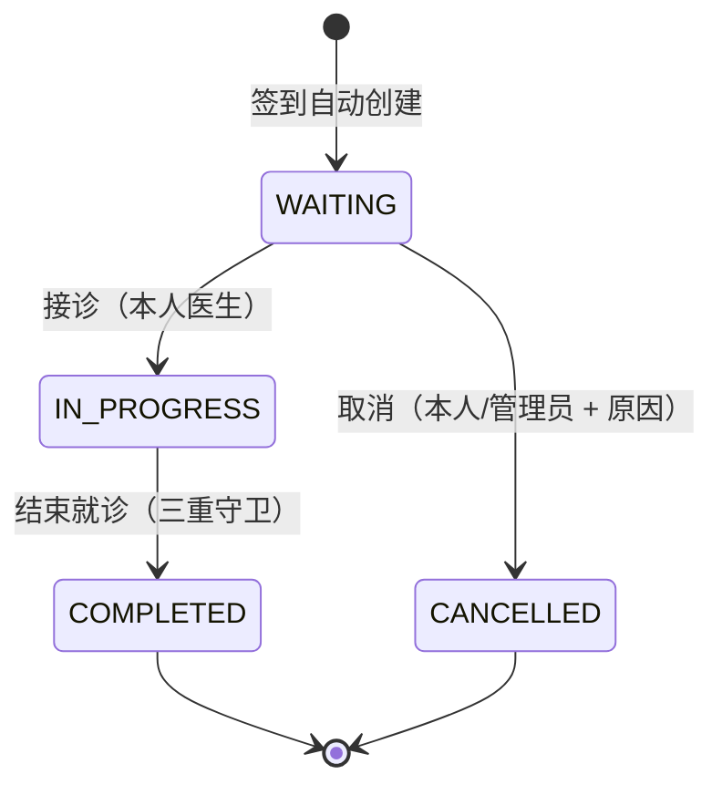
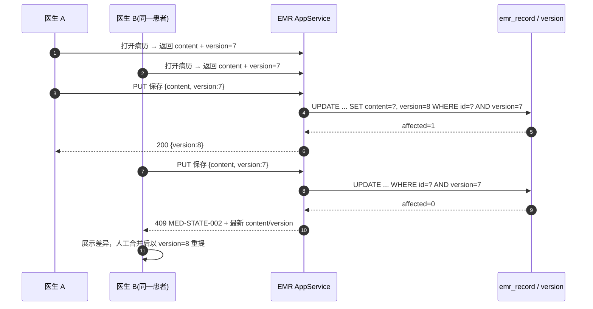
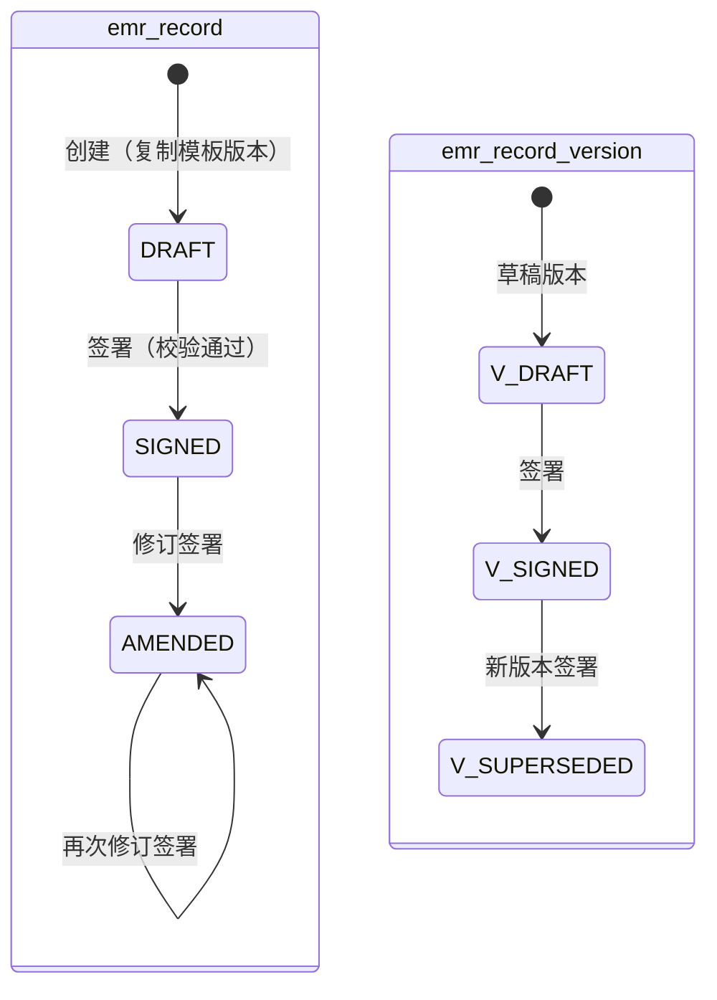
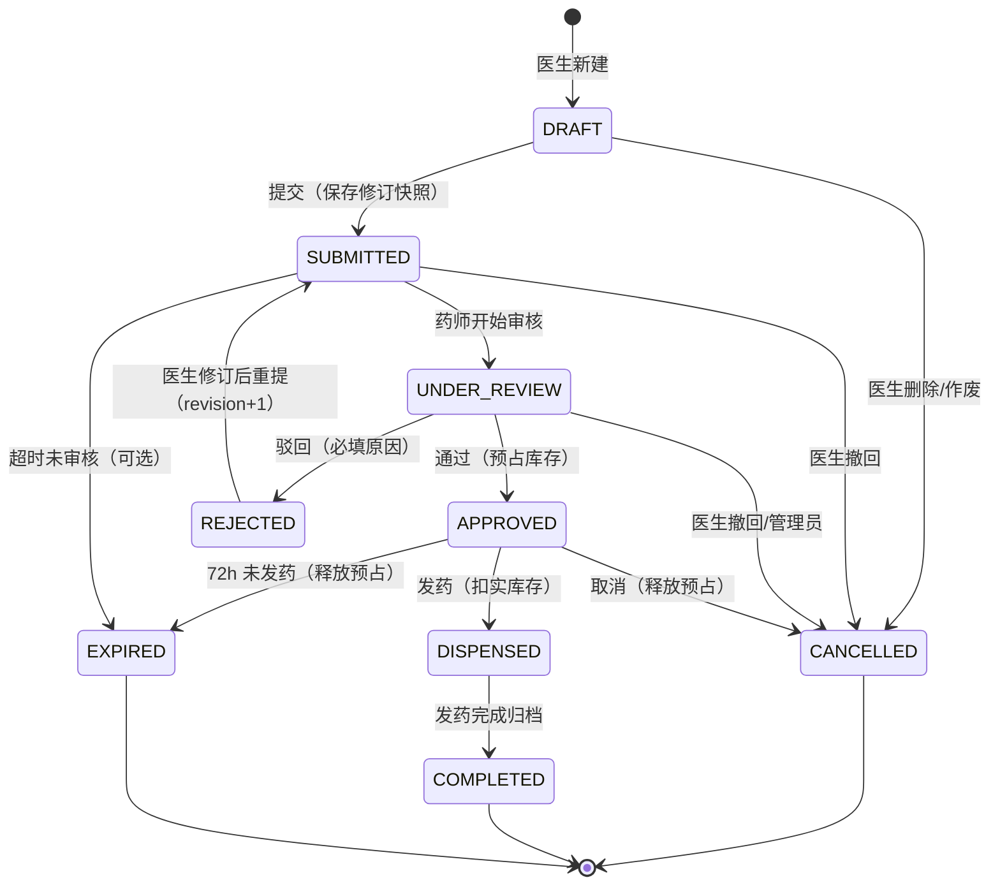
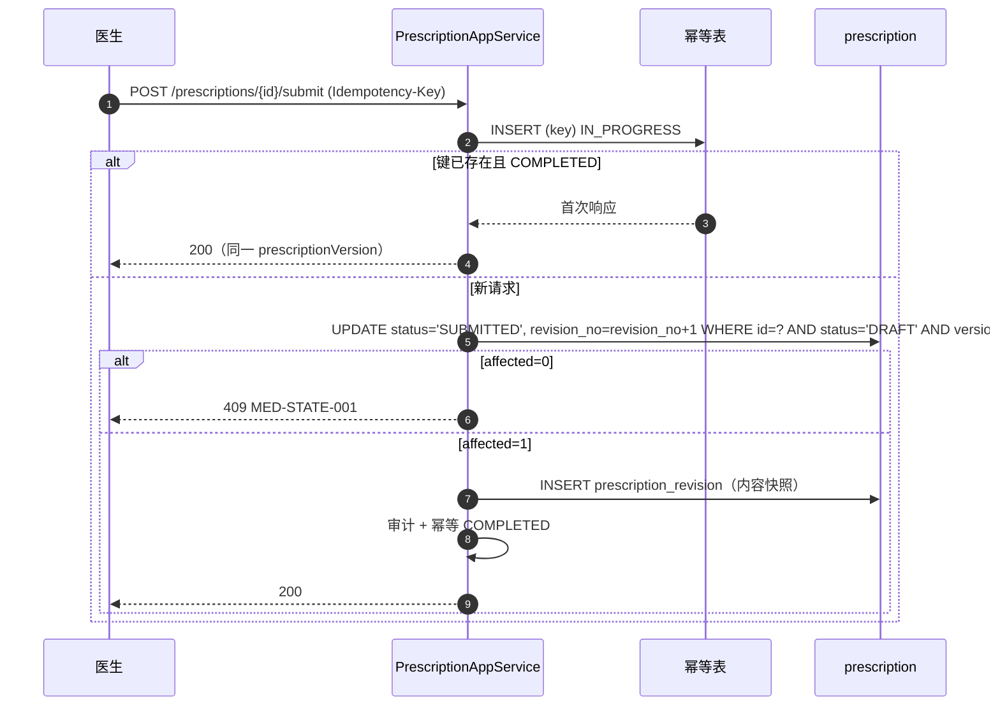
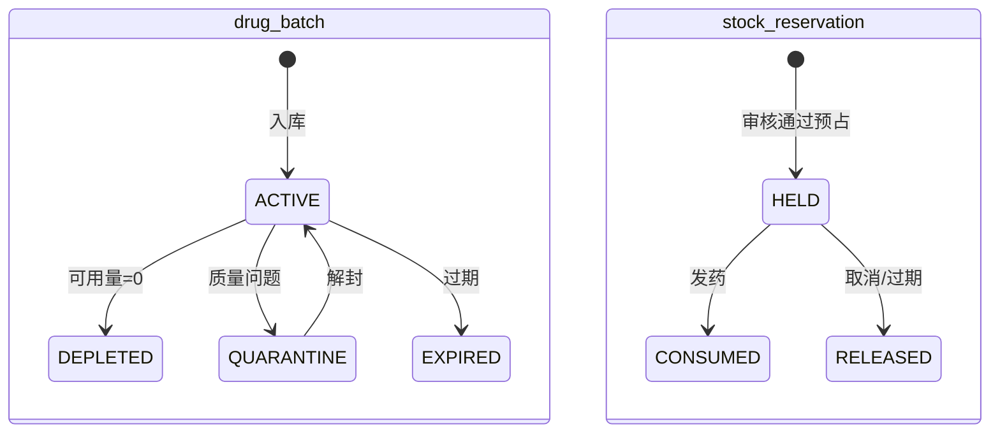
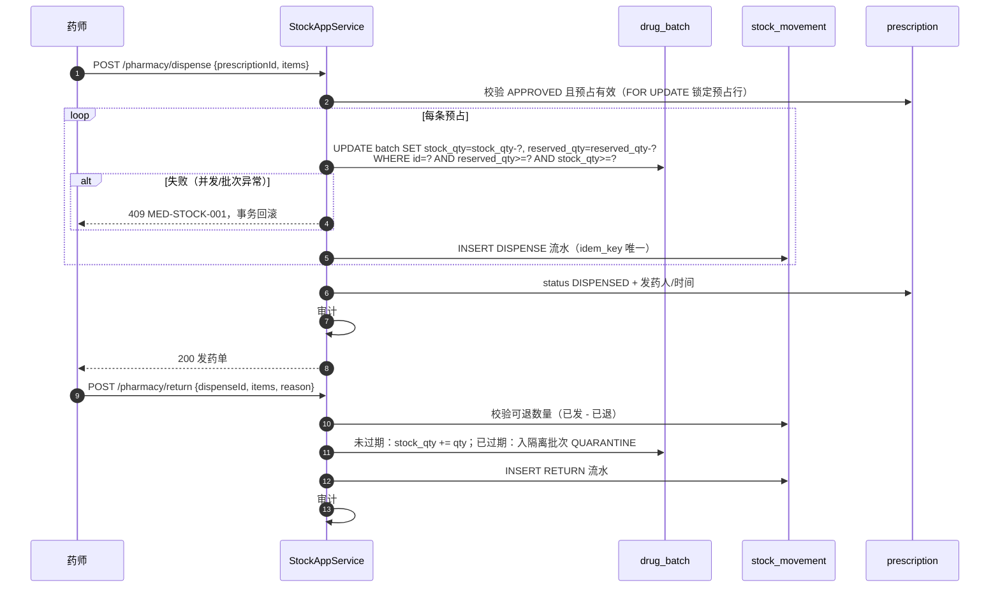

# MedFlow 业务流程与状态机设计

| 项 | 值 |
| --- | --- |
| 版本 | v1.0（第一阶段） |
| 关联文档 | `requirements.md`、`database-design.md`、`architecture.md` |
| 图形语法 | Mermaid `stateDiagram-v2` / `sequenceDiagram` |

## 1. 全局设计约定

### 1.1 一次请求的固定顺序

```text
HTTP → 认证过滤器(JWT) → 权限注解(角色/权限码) → 幂等拦截(可写接口)
     → 应用服务 @Transactional → 领域规则(状态机/校验) → 仓储
     → 审计 + 业务流水 + 事件(同事务) → 提交 → 响应(ProblemDetail 或 DTO)
```

任何一步失败都不得留下"状态改了但流水没写"或"库存扣了但处方没变"的中间态。

### 1.2 统一错误码

| 错误码 | HTTP | 含义 | 前端处理 |
| --- | --- | --- | --- |
| `MED-AUTH-001` | 401 | 凭据无效/令牌过期 | 跳登录或静默刷新 |
| `MED-AUTH-002` | 423 | 账号锁定 | 显示解锁时间 |
| `MED-AUTHZ-001` | 403 | 无权限或跨科室 | 提示无权限 |
| `MED-NOT-FOUND` | 404 | 资源不存在或不可见 | 提示并返回列表 |
| `MED-STATE-001` | 409 | 非法状态转换 | 刷新最新状态 |
| `MED-STATE-002` | 409 | 乐观锁版本冲突 | 展示最新数据供合并 |
| `MED-SLOT-001` | 409 | 号源已满 | 刷新号源列表 |
| `MED-SLOT-002` | 409 | 重复预约 | 高亮已有预约 |
| `MED-STOCK-001` | 409 | 库存不足（含药品与可用量） | 提示缺药清单 |
| `MED-IDEM-001` | 409 | 相同幂等键的请求正在处理 | 短暂重试 |
| `MED-VALID-001` | 422 | 参数/模板校验失败（含字段级错误） | 定位到字段 |
| `MED-EXPIRED-001` | 410 | 号源/处方已过期 | 重新选择 |

响应体遵循 RFC 9457 `application/problem+json`，扩展字段：`code`、`requestId`、`fieldErrors[]`、`conflict`（冲突时的最新数据）。

### 1.3 幂等约定

| 场景 | 幂等键 | 存储 | 重复请求行为 |
| --- | --- | --- | --- |
| 预约挂号 | 客户端 `Idempotency-Key` | `sys_idempotency_record` | 已成功：回放首次响应；处理中：409 |
| 收费/退费 | `charge_order.order_no + action` | `sys_idempotency_record` | 同上 |
| 病历自动保存 | `recordId + version`（乐观锁） | `emr_record` | 旧版本 409，不覆盖 |
| 处方提交 | 客户端 `Idempotency-Key` | `sys_idempotency_record` | 回放同一处方 |
| 发药/退药 | `prescriptionId + revision + action` | `stock_movement.idem_key` 唯一索引 | 返回既有流水，不重复扣减 |
| 取消/过期释放预占 | `prescriptionId + revision + action` | `stock_reservation.idem_key` | 已释放则直接成功 |

> 原则：**业务唯一键优先于幂等表**。例如 `stock_movement.idem_key` 由业务语义生成，即使客户端重试也不会重复扣库存。

### 1.4 数据范围（后端强制）

| 资源 | ADMIN | DOCTOR | NURSE | PHARMACIST | CASHIER |
| --- | --- | --- | --- | --- | --- |
| 患者查询 | 无临床权限 | 本科室（有就诊关系） | 本科室 | 全院（发药核对） | 本科室 |
| 预约/就诊 | 无 | 本人 | 本科室 | 无 | 本科室 |
| 排班 | 查看 | 本科室，仅本人可改 | 本科室查看 | 无 | 本科室查看 |
| 处方 | 无 | 本人开具 | 无 | 全院 | 无 |
| 库存 | 无 | 无 | 无 | 全院 | 无 |
| 审计/用户/角色 | 全院 | 无 | 无 | 无 | 无 |

实现：`DataScopeResolver` 计算 `(scope, deptIds, userId)`，仓储查询强制拼接范围条件；写操作额外校验资源归属，越权返回 403；不可见资源返回 404 以避免探测。

## 2. M2 预约挂号

### 2.1 状态机



| 当前 | 动作 | 目标 | 操作人 | 守卫条件 | 副作用（同事务） |
| --- | --- | --- | --- | --- | --- |
| — | `book` | `BOOKED` | 收费员 | 号源 `OPEN` 且有余量；患者无同号源活动预约；同医生同日无第二活动预约 | 号源 `booked_count+1`；创建 `charge_order(UNPAID)`；审计 |
| `BOOKED` | `checkIn` | `CHECKED_IN` | 护士 | 就诊当日；号源未结束；患者已到院 | 创建 `encounter(WAITING)` 并回填 `appointment.encounter_id`；审计 |
| `BOOKED` | `cancel` | `CANCELLED` | 收费员/管理员 | 未签到 | 号源 `booked_count-1`（不小于 0）；挂号单 `REFUND_PENDING`；审计 |
| `CHECKED_IN` | `cancel` | `CANCELLED` | 管理员 | 必须填写原因 | 关联 `encounter` 取消；退款；审计 |
| `CHECKED_IN` | `start` | `IN_CONSULTATION` | 本人医生 | 就诊 `WAITING` | 就诊 `IN_PROGRESS`；审计 |
| `IN_CONSULTATION` | `complete` | `COMPLETED` | 本人医生 | 病历已签署 + 主诊断 + 无草稿处方 | 就诊 `COMPLETED`；审计 |
| `BOOKED/CHECKED_IN` | `expire` | `NO_SHOW` | 系统 | 就诊日已结束且未接诊 | 不退款；审计（系统操作人） |

### 2.2 并发预约防超卖（核心）



设计要点：

1. **不使用"先查余量再更新"**。查询与写入之间的窗口正是超卖来源；用单条 `UPDATE ... WHERE booked_count < capacity` 把判断和扣减合并为原子操作。
2. `booked_count` 受 `CHECK (booked_count >= 0 AND booked_count <= capacity)` 约束兜底。
3. 唯一索引 `uk_appointment_active(slot_id, active_patient_id)`：`active_patient_id` 是生成列，仅活动状态取值，终态为 `NULL`（MySQL 唯一索引允许多个 `NULL`），从而允许"取消后重新预约同一号源"。
4. 同一患者同医生同一天重复预约在应用层校验，并有 `uk_appointment_patient_doctor_day(patient_id, doctor_id, appointment_date, active_flag)` 生成列约束兜底。
5. 幂等记录与业务写入**同事务**；事务回滚时幂等记录不落库（或落 `FAILED` 供重试），避免"幂等键占位成功但业务失败"。
6. 号源余量查询展示 `capacity - booked_count`，不单独维护 `remaining`，避免双写不一致。

### 2.3 取消与退号补偿



补偿原则：**本地状态先行、外部副作用可重试**。预约取消必须在本地事务内成功；退款失败不回滚取消（否则患者已被告知取消），而是进入可观测的失败队列。`refund_no` 作为支付侧幂等键。

## 3. M3 医生工作站

### 3.1 就诊状态机



结束就诊守卫（全部满足才允许，否则 409 并返回 `unmetConditions[]`）：

1. 病历记录状态 ∈ {`SIGNED`, `AMENDED`}（当前医生已签署）；
2. 至少一条诊断，且存在主诊断；
3. 本次就诊下不存在 `DRAFT` 状态处方；
4. 就诊状态为 `IN_PROGRESS`。

### 3.2 并发编辑与乐观锁



自动保存策略：

- 前端监听表单变化，**2 秒防抖**后调用 `PUT /encounters/{id}/emr/draft`；
- 每次保存都携带当前 `version`，成功则更新本地版本；409 时停止自动保存并提示冲突；
- 草稿同时写 Redis（`emr:draft:{recordId}:{userId}`，TTL 24h）作为快速恢复副本，数据库 `emr_record` 为唯一事实源；
- 页面加载时先取数据库版本，若 Redis 草稿 `updatedAt` 更新且哈希不同，提示"发现未同步草稿，是否恢复"；
- 禁止用草稿覆盖已签署版本；签署动作会清除草稿。

## 4. M4 电子病历

### 4.1 版本与签署状态机



| 动作 | 前置 | 结果 | 禁止 |
| --- | --- | --- | --- |
| `saveDraft` | 记录 `DRAFT`；当前版本 `DRAFT` | 版本内容更新 + `version+1` | 覆盖已签署版本 |
| `sign` | 记录 `DRAFT`；模板校验通过；作者本人 | 版本 `SIGNED`、记录 `SIGNED`、写哈希/签署人/时间 | 缺必填字段、非作者 |
| `revise` | 记录 `SIGNED`/`AMENDED`；无开放草稿版本 | 新版本号 `N+1` 且 `DRAFT`；记录保持不变 | 同时存在两个草稿修订 |
| `signRevision` | 开放草稿版本；校验通过 | 旧版本 `SUPERSEDED`，新版本 `SIGNED`，记录 `AMENDED` | 修改旧版本内容 |
| `discardRevision` | 开放草稿版本 | 草稿版本删除（或标记 `DISCARDED`），记录保持 | 删除已签署版本 |

### 4.2 动态表单与条件联动

模板 Schema（简化示例）：

```json
{
  "version": 3,
  "sections": [
    {
      "key": "chief",
      "title": "主诉与现病史",
      "fields": [
        { "key": "chiefComplaint", "type": "textarea", "label": "主诉", "required": true, "maxLength": 200 },
        { "key": "fever", "type": "boolean", "label": "发热" },
        { "key": "temperature", "type": "number", "label": "体温(℃)", "unit": "℃",
          "visibleWhen": { "field": "fever", "op": "eq", "value": true },
          "requiredWhen": { "field": "fever", "op": "eq", "value": true },
          "min": 34, "max": 43 },
        { "key": "onsetDate", "type": "date", "label": "发病日期", "max": "$today" }
      ]
    }
  ],
  "rules": [
    { "type": "crossField", "when": { "field": "temperature", "op": "gte", "value": 39 },
      "then": { "field": "feverLevel", "op": "setRequired", "value": true } }
  ]
}
```

校验执行顺序：隐藏字段剔除 → 类型/范围/长度 → 条件必填 → 跨字段规则 → 服务端模板版本一致性 → 权限（作者/接诊医生）。前端与后端使用同一份规则语义，但**后端是唯一权威**；后端不接受前端传入的"已校验"标记。

### 4.3 签署不可变与审计

- 签署时对 `{templateVersion, content, signerId, signedAt}` 做规范化 JSON（键排序）后计算 SHA-256，存入 `content_hash`；
- 所有更新 SQL 都带 `status='DRAFT'` 条件，已签署版本在数据库层无法被覆盖；
- 修订生成新版本而非改旧版本，历史页按版本号倒序展示；
- 审计记录 `EMR_SIGNED` / `EMR_REVISED`，包含 `beforeVersion`、`afterVersion`、`hash`，不记录病历正文（隐私）。

## 5. M5 处方与医嘱

### 5.1 状态机



| 当前 | 动作 | 目标 | 操作人 | 守卫 | 副作用 |
| --- | --- | --- | --- | --- | --- |
| `DRAFT` | `submit` | `SUBMITTED` | 开具医生 | 至少 1 条明细；药品启用；剂量/数量合法 | 生成 `prescription_revision` 快照；审计 |
| `SUBMITTED` | `startReview` | `UNDER_REVIEW` | 药师 | 未被他人锁定 | 记录审核人；审计 |
| `UNDER_REVIEW` | `approve` | `APPROVED` | 审核药师 | 库存足量 | 逐批预占；生成 `stock_reservation`；审计 |
| `UNDER_REVIEW` | `reject` | `REJECTED` | 审核药师 | 原因非空 | 审计（含原因）；不占库存 |
| `REJECTED` | `submit` | `SUBMITTED` | 开具医生 | 已修改内容；revision+1 | 新快照；审计 |
| `DRAFT/SUBMITTED/UNDER_REVIEW` | `cancel` | `CANCELLED` | 医生/药师/管理员 | 未通过审核或已释放 | 审计 |
| `APPROVED` | `cancel` | `CANCELLED` | 医生/药师/管理员 | 未发药 | 释放全部预占（幂等）；审计 |
| `APPROVED` | `dispense` | `DISPENSED` | 药师 | 预占有效；未过期 | 扣实库存；出库流水；审计 |
| `DISPENSED` | `complete` | `COMPLETED` | 系统/药师 | 发药流水完整 | 归档 |
| `APPROVED` | `expire` | `EXPIRED` | 系统 | 超过 72h | 释放预占；审计 |

### 5.2 提交幂等与审核



审核审计必须回答：**谁、何时、对哪个修订版本、做了什么决定、原因是什么**。因此 `prescription_review` 记录 `revision_no`，药师驳回后医生重提会产生新修订，旧审核记录仍指向旧修订，不覆盖。

## 6. M6 药房库存

### 6.1 批次与预占状态



### 6.2 FEFO 预占算法（伪代码）

```text
reserve(prescription):
  for item in prescription.items:                      # 固定顺序：item.id ASC
    remaining = item.quantity
    batches = SELECT * FROM drug_batch
              WHERE drug_id=? AND status='ACTIVE'
                AND expiry_date > :today
                AND stock_qty - reserved_qty > 0
              ORDER BY expiry_date ASC, id ASC          # 先过期先出，稳定排序防死锁
    for b in batches:
      take = min(remaining, b.stock_qty - b.reserved_qty)
      affected = UPDATE drug_batch
                 SET reserved_qty = reserved_qty + :take, version = version + 1
                 WHERE id=:b.id AND stock_qty - reserved_qty >= :take
      if affected == 0: continue                        # 被并发抢走，换下一批
      INSERT stock_reservation(HELD, take, idem_key)
      INSERT stock_movement(RESERVE, take, before, after)
      remaining -= take
      if remaining == 0: break
    if remaining > 0:
      throw InsufficientStock(drug, available)          # 抛异常 → 整个事务回滚
```

要点：

- **整单全成或全败**：任何一个药品不足都抛异常回滚，不留下"部分药已预占"。
- 条件更新而不是 `SELECT ... FOR UPDATE` 批量锁行，短事务、低锁竞争；`ORDER BY` 固定避免死锁。
- `available = stock_qty - reserved_qty` 由数据库约束 `CHECK (reserved_qty >= 0 AND reserved_qty <= stock_qty)` 保证非负。
- 预占流水 `stock_movement` 记录 `before_qty/after_qty`，可用于对账重放。

### 6.3 发药、退药与失败补偿



| 失败点 | 处理 | 幂等方式 |
| --- | --- | --- |
| 审核通过时库存不足 | 整体回滚，处方保持 `UNDER_REVIEW`，返回缺药明细 | 幂等键未完成可重试 |
| 发药时批次可用量被并发消耗 | 回滚本次发药，提示重新选择批次/重试 | `idem_key = dispense:{rx}:{rev}:{batch}` |
| 发药成功后响应丢失 | 客户端重试 → 命中 `idem_key`，返回既有发药结果 | 流水唯一索引 |
| 取消/过期释放预占 | 逐条 `reserved_qty -= qty`（条件 `>=`），预占置 `RELEASED` | `idem_key = release:{rx}:{rev}` |
| 退款失败（M2） | 本地取消已生效，退款单进入 `FAILED` 重试队列 | 支付侧幂等键 `refund_no` |

### 6.4 一致性对账

每日/按需执行（也作为集成测试断言）：

```sql
-- 1) 批次级：实库存 = 入库(IN) + 退药(RETURN) + 调整(ADJUST) - 发药(DISPENSE)
-- 2) 预占级：reserved_qty = SUM(HELD 预占数量)
-- 3) 单据级：DISPENSED 处方的出库流水数量 = 处方明细数量 - 已退数量
-- 4) 全局：stock_qty >= reserved_qty >= 0
```

对账差异不自动修复，生成核对任务由药师确认；这是医疗系统的常见做法。

## 7. 跨模块事件与事务边界

| 场景 | 事务边界 | 跨模块协作 |
| --- | --- | --- |
| 预约挂号 | 单事务：号源 + 预约 + 挂号单 + 幂等 + 审计 | 无外部调用 |
| 取消/退号 | 单事务：预约 + 号源 + 退款单 + 审计；退款异步 | 支付网关（模拟）异步重试 |
| 签到 | 单事务：预约 + 就诊创建 + 审计 | 无 |
| 接诊/结束 | 单事务：就诊 + 预约状态 + 审计（结束前只读校验病历与处方） | 读取 EMR/处方当前状态 |
| 病历签署/修订 | 单事务：版本 + 记录 + 审计 | 无 |
| 处方审核通过 | 单事务：处方 + 预占 + 流水 + 审计 | 同库，无分布式事务 |
| 发药 | 单事务：批次 + 预占 + 流水 + 处方 + 审计 | 无 |
| 取消/过期处方 | 单事务：处方 + 释放预占 + 流水 + 审计 | 无 |

> 由于采用单体单库，跨模块写操作都在同一本地事务内，**不引入分布式事务**。`outbox_event` 只用于未来可能的外部集成（通知、对账），不参与核心正确性。

## 8. 审计事件清单

| 事件 | 资源 | 必记字段 |
| --- | --- | --- |
| `AUTH_LOGIN_SUCCESS` / `AUTH_LOGIN_FAILED` | user | 用户名、IP、UA、结果 |
| `ROLE_PERMISSION_CHANGED` | role | 变更前后权限集合 |
| `PATIENT_CREATED` / `PATIENT_UPDATED` | patient | 变更字段（脱敏） |
| `APPOINTMENT_BOOKED` / `CANCELLED` / `CHECKED_IN` | appointment | 号源、患者、操作人、原因 |
| `ENCOUNTER_STARTED` / `COMPLETED` | encounter | 就诊号、医生、耗时 |
| `EMR_SIGNED` / `EMR_REVISED` | emr_record | 版本号、哈希、原因 |
| `PRESCRIPTION_SUBMITTED` / `REVIEWED` / `CANCELLED` | prescription | 修订号、审核人、原因 |
| `STOCK_RESERVED` / `DISPENSED` / `RETURNED` / `RELEASED` | drug_batch | 批次、数量、余额、业务键 |

审计表只追加，不提供更新/删除接口；管理员只能按条件查询与导出。
