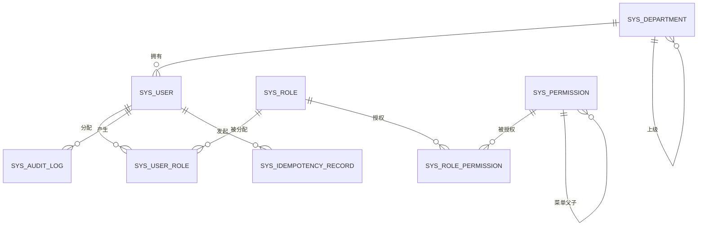
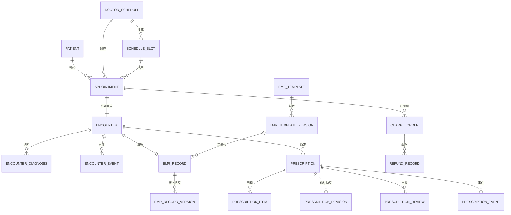
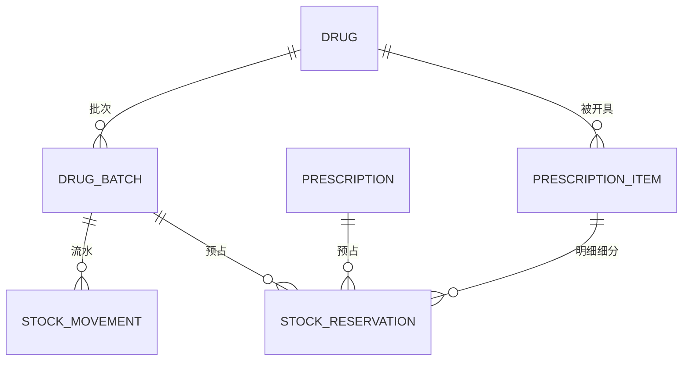

# MedFlow 数据库设计

| 项 | 值 |
| --- | --- |
| 数据库 | MySQL 8.4 LTS（InnoDB / utf8mb4） |
| 迁移工具 | Flyway 12（版本化脚本 + dev 种子脚本） |
| ORM | MyBatis-Plus 3.5（简单查询）+ 手写 SQL（并发关键路径） |
| 时区 | 连接与会话统一 `Asia/Shanghai`，时间列 `DATETIME(3)` |
| 事务隔离 | 默认 `REPEATABLE READ`；依赖条件更新与唯一约束而非隔离级别 |

## 1. 设计原则

1. **业务单据不可删除**：状态字段表达生命周期；逻辑删除 `deleted` 只用于主数据（用户、药品、模板）。
2. **金额 `DECIMAL(10,2)`**，禁止浮点；数量用 `INT`（药片/支/瓶，整数单位）。
3. **每个业务表带审计列**：`created_at/created_by/updated_at/updated_by/version`；追加型表（审计、流水、事件）不带 `updated_*`。
4. **乐观锁统一 `version INT`**，由 MyBatis-Plus `@Version` 与手写 SQL 的 `AND version=?` 共同维护。
5. **状态用 `VARCHAR(32)` + 应用枚举**，不使用 MySQL `ENUM`（迁移困难、ORM 映射差）；关键状态列建索引。
6. **唯一约束是最后防线**：并发正确性不能只靠应用层 `if` 判断。
7. **外键用于结构关系**（`ON DELETE RESTRICT`），审计/流水表不建外键以降低写放大；数据完整性由事务与测试保证。
8. **JSON 只存快照/Schema**，不存需要检索的业务字段；JSON 列不可作为唯一约束依据（生成列除外）。

## 2. 命名与类型约定

| 对象 | 规则 | 示例 |
| --- | --- | --- |
| 表 | `模块前缀_实体`，小写下划线 | `appointment`, `emr_record_version` |
| 主键 | `id BIGINT UNSIGNED AUTO_INCREMENT` | `id` |
| 业务编号 | `xxx_no VARCHAR(32)`，唯一，可读 | `AP202610260001` |
| 外键 | `{实体}_id`，同类型 | `patient_id` |
| 状态 | `status VARCHAR(32)` | `BOOKED` |
| 布尔 | `TINYINT(1)` | `built_in` |
| 枚举 | 大写下划线字符串 | `UNDER_REVIEW` |
| 索引 | `idx_表_列` / `uk_表_列` | `uk_user_username` |
| 时间 | `DATETIME(3)`，UTC+8 | `2026-10-26 09:30:00.000` |

业务编号生成：`sys_sequence(name, next_value)` 原子自增（`UPDATE ... SET next_value = LAST_INSERT_ID(next_value+1)`），按日重置由名称携带日期实现（如 `AP-20261026`），避免依赖 Redis 可用性。

## 3. ER 总览

### 3.1 权限与基础数据（M1）



### 3.2 门诊主链路（M2–M5）



### 3.3 药房库存（M6）



## 4. 表设计

### 4.1 通用审计列（下文以 `…audit` 简写）

| 列 | 类型 | 说明 |
| --- | --- | --- |
| `created_at` | `DATETIME(3) NOT NULL DEFAULT CURRENT_TIMESTAMP(3)` | 创建时间 |
| `created_by` | `BIGINT UNSIGNED NULL` | 创建人（系统任务为 NULL） |
| `updated_at` | `DATETIME(3) NOT NULL DEFAULT CURRENT_TIMESTAMP(3) ON UPDATE CURRENT_TIMESTAMP(3)` | 更新时间 |
| `updated_by` | `BIGINT UNSIGNED NULL` | 更新人 |
| `version` | `INT NOT NULL DEFAULT 0` | 乐观锁版本 |

### 4.2 M1 基础与权限

#### `sys_department` 科室

| 列 | 类型 | 约束 | 说明 |
| --- | --- | --- | --- |
| `id` | BIGINT UNSIGNED | PK | |
| `code` | VARCHAR(32) | NOT NULL, UK | `DERM` / `PHARMACY` |
| `name` | VARCHAR(64) | NOT NULL | 皮肤科 |
| `parent_id` | BIGINT UNSIGNED | NULL, FK self | 支持院区/科室层级 |
| `type` | VARCHAR(16) | NOT NULL | `CLINICAL` / `PHARMACY` / `ADMIN` |
| `status` | VARCHAR(16) | NOT NULL DEFAULT 'ENABLED' | `ENABLED` / `DISABLED` |
| `sort_no` | INT | NOT NULL DEFAULT 0 | |
| `…audit` | | | |

索引：`uk_department_code(code)`。

#### `sys_user` 用户

| 列 | 类型 | 约束 | 说明 |
| --- | --- | --- | --- |
| `id` | BIGINT UNSIGNED | PK | |
| `username` | VARCHAR(50) | NOT NULL, UK | 登录名 |
| `password_hash` | VARCHAR(100) | NOT NULL | BCrypt(12) |
| `real_name` | VARCHAR(50) | NOT NULL | |
| `employee_no` | VARCHAR(32) | UK, NULL | 工号 |
| `dept_id` | BIGINT UNSIGNED | NOT NULL, FK | 所属科室 |
| `title` | VARCHAR(32) | NULL | 主任医师等 |
| `phone` | VARCHAR(20) | NULL | 合成号码 |
| `status` | VARCHAR(16) | NOT NULL DEFAULT 'ENABLED' | `ENABLED` / `DISABLED` / `LOCKED` |
| `last_login_at` | DATETIME(3) | NULL | |
| `password_changed_at` | DATETIME(3) | NULL | 用于强制改密 |
| `…audit` | | | |

索引：`uk_user_username`、`uk_user_employee_no`、`idx_user_dept_status(dept_id,status)`。

#### `sys_role` / `sys_permission` / 关联表

| 表 | 关键列 | 约束/索引 |
| --- | --- | --- |
| `sys_role` | `code`(UK), `name`, `data_scope`(ALL/DEPT/SELF), `built_in`, `status`, `remark`, audit | `uk_role_code` |
| `sys_permission` | `code`(UK), `name`, `type`(MENU/BUTTON/API), `parent_id`, `route_path`, `component`, `icon`, `http_method`, `api_pattern`, `sort_no`, `status`, audit | `uk_permission_code`, `idx_permission_parent(parent_id)` |
| `sys_user_role` | `user_id`, `role_id`, `created_at` | PK(user_id, role_id)，两个 FK |
| `sys_role_permission` | `role_id`, `permission_id`, `created_at` | PK(role_id, permission_id) |

#### `sys_audit_log` 审计日志（追加型）

| 列 | 类型 | 说明 |
| --- | --- | --- |
| `id` | BIGINT UNSIGNED PK | |
| `trace_id` | VARCHAR(64) | 请求链路 ID |
| `actor_id` / `actor_name` | BIGINT / VARCHAR(50) | 操作人快照 |
| `action` | VARCHAR(64) | `EMR_SIGNED` |
| `resource_type` / `resource_id` | VARCHAR(32) / VARCHAR(64) | 资源定位 |
| `result` | VARCHAR(16) | `SUCCESS` / `FAILURE` |
| `error_code` | VARCHAR(32) | 失败错误码 |
| `before_json` / `after_json` | JSON | 变更快照（脱敏） |
| `ip` / `user_agent` | VARCHAR(45) / VARCHAR(255) | 来源 |
| `created_at` | DATETIME(3) | 不提供更新/删除 |

索引：`idx_audit_resource(resource_type,resource_id,created_at)`、`idx_audit_actor(actor_id,created_at)`、`idx_audit_created(created_at)`。

#### `sys_idempotency_record` 幂等记录

| 列 | 类型 | 说明 |
| --- | --- | --- |
| `id` | BIGINT UNSIGNED PK | |
| `idem_key` | VARCHAR(80) | 客户端生成 |
| `user_id` | BIGINT UNSIGNED | 作用域 |
| `method` / `path` | VARCHAR(10) / VARCHAR(255) | 请求定位 |
| `request_hash` | CHAR(64) | 请求体 SHA-256，防止同键不同体 |
| `status` | VARCHAR(16) | `IN_PROGRESS` / `COMPLETED` / `FAILED` |
| `response_status` | INT | 首次响应码 |
| `response_body` | JSON | 首次响应快照 |
| `error_code` | VARCHAR(32) | |
| `expires_at` | DATETIME(3) | 过期清理（24h） |
| `created_at` / `updated_at` | DATETIME(3) | |

索引：`uk_idem_user_key(user_id, idem_key)`、`idx_idem_expires(expires_at)`。

> 冲突处理：插入失败时读取已有记录；`COMPLETED` 回放，`IN_PROGRESS` 返回 409，`FAILED` 允许原键重试（覆盖该行）。

#### `sys_sequence` 业务编号序列

`name VARCHAR(64) PK`，`next_value BIGINT NOT NULL`，`updated_at DATETIME(3)`。

### 4.3 患者

#### `patient` 患者主档

| 列 | 类型 | 约束/说明 |
| --- | --- | --- |
| `id` | BIGINT UNSIGNED | PK |
| `patient_no` | VARCHAR(32) | NOT NULL, UK，`P00000001` |
| `name` | VARCHAR(50) | NOT NULL |
| `gender` | VARCHAR(8) | `MALE` / `FEMALE` / `UNKNOWN` |
| `birth_date` | DATE | NOT NULL |
| `id_card_hash` | CHAR(64) | 证件号 SHA-256（加盐），用于查重，不存明文 |
| `id_card_masked` | VARCHAR(32) | `310***********1234` |
| `phone` | VARCHAR(20) | 合成号码 |
| `address` | VARCHAR(255) | 合成地址 |
| `allergy_history` | VARCHAR(500) | 过敏史（自由文本） |
| `status` | VARCHAR(16) | `ACTIVE` / `ARCHIVED` |
| `…audit` | | |

索引：`uk_patient_no`、`uk_patient_id_card_hash`、`idx_patient_name_birth(name,birth_date)`、`idx_patient_phone(phone)`。

### 4.4 M2 排班与预约

#### `doctor_schedule` 排班

| 列 | 类型 | 说明 |
| --- | --- | --- |
| `id` | BIGINT UNSIGNED PK | |
| `dept_id` / `doctor_id` | BIGINT UNSIGNED | FK |
| `schedule_date` | DATE | |
| `period` | VARCHAR(8) | `AM` / `PM` |
| `start_time` / `end_time` | TIME | `08:00`–`12:00` |
| `room` | VARCHAR(32) | 诊室 |
| `status` | VARCHAR(16) | `DRAFT` / `PUBLISHED` / `CLOSED` / `CANCELLED` |
| `published_at` / `published_by` | DATETIME(3) / BIGINT | |
| `active_key` | VARCHAR(96) GENERATED STORED | 活动排班去重键 |
| `…audit` | | |

生成列：

```sql
active_key VARCHAR(96) GENERATED ALWAYS AS (
  CASE WHEN status IN ('DRAFT','PUBLISHED')
       THEN CONCAT(doctor_id, '-', schedule_date, '-', period) END
) STORED,
UNIQUE KEY uk_schedule_active (active_key)
```

索引：`idx_schedule_dept_date(dept_id, schedule_date, status)`、`idx_schedule_doctor_date(doctor_id, schedule_date)`。

#### `schedule_slot` 号源

| 列 | 类型 | 说明 |
| --- | --- | --- |
| `id` | BIGINT UNSIGNED PK | |
| `schedule_id` | BIGINT UNSIGNED | FK |
| `seq_no` | INT | 序号，从 1 开始 |
| `start_time` / `end_time` | TIME | |
| `capacity` | INT | 容量（通常 1，可支持加号） |
| `booked_count` | INT | 已约数 |
| `status` | VARCHAR(16) | `OPEN` / `CLOSED` |
| `…audit` | | |

约束：`uk_slot_schedule_seq(schedule_id, seq_no)`、`chk_slot_count CHECK (booked_count >= 0 AND booked_count <= capacity)`。
索引：`idx_slot_schedule_status(schedule_id, status)`。

> 余量 = `capacity - booked_count`，不冗余存储。

#### `appointment` 预约

| 列 | 类型 | 说明 |
| --- | --- | --- |
| `id` | BIGINT UNSIGNED PK | |
| `appointment_no` | VARCHAR(32) UK | `AP202610260001` |
| `patient_id` / `dept_id` / `doctor_id` | BIGINT UNSIGNED | FK |
| `schedule_id` / `slot_id` | BIGINT UNSIGNED | FK |
| `appointment_date` | DATE | 冗余便于查询 |
| `period` / `seq_no` | VARCHAR(8) / INT | 冗余，展示用 |
| `status` | VARCHAR(32) | `BOOKED` / `CHECKED_IN` / `IN_CONSULTATION` / `COMPLETED` / `CANCELLED` / `NO_SHOW` |
| `source` | VARCHAR(16) | `WINDOW` / `SELF_SERVICE` |
| `booked_by` | BIGINT UNSIGNED | 收费员 |
| `checked_in_at` / `cancelled_at` | DATETIME(3) | |
| `cancel_reason` | VARCHAR(255) | |
| `encounter_id` | BIGINT UNSIGNED NULL | 签到后回填 |
| `active_patient_id` | BIGINT GENERATED | 活动预约患者，唯一约束用 |
| `active_doctor_day_key` | VARCHAR(96) GENERATED | 患者+医生+日期+半天去重 |
| `…audit` | | |

生成列与索引：

```sql
active_patient_id BIGINT GENERATED ALWAYS AS (
  CASE WHEN status IN ('BOOKED','CHECKED_IN','IN_CONSULTATION') THEN patient_id END
) STORED,
active_doctor_day_key VARCHAR(96) GENERATED ALWAYS AS (
  CASE WHEN status IN ('BOOKED','CHECKED_IN','IN_CONSULTATION')
       THEN CONCAT(patient_id, '-', doctor_id, '-', appointment_date, '-', period) END
) STORED,
UNIQUE KEY uk_appointment_slot_patient (slot_id, active_patient_id),
UNIQUE KEY uk_appointment_doctor_day (active_doctor_day_key),
KEY idx_appointment_patient_date (patient_id, appointment_date),
KEY idx_appointment_doctor_status (doctor_id, appointment_date, status),
KEY idx_appointment_dept_date (dept_id, appointment_date)
```

> 取消后可重新预约同一号源：终态时两个生成列为 `NULL`，MySQL 唯一索引允许多行 `NULL`。

#### `charge_order` / `refund_record` 收费与退款

| 表 | 关键列 | 约束/索引 |
| --- | --- | --- |
| `charge_order` | `order_no` UK, `biz_type`(REGISTRATION/PRESCRIPTION), `biz_id`, `patient_id`, `dept_id`, `amount` DECIMAL(10,2), `status`(UNPAID/PAID/REFUND_PENDING/REFUNDED/CANCELLED), `payment_method`, `paid_at`, `cashier_id`, audit | `uk_charge_biz(biz_type,biz_id)`、`idx_charge_patient(patient_id,created_at)`、`idx_charge_status(status)` |
| `refund_record` | `refund_no` UK, `charge_id`, `biz_type`, `biz_id`, `amount`, `reason`, `status`(PENDING/SUCCESS/FAILED), `retry_count`, `last_error`, `operator_id`, `refunded_at`, `idem_key` UK | `uk_refund_idem(idem_key)`、`idx_refund_status_retry(status,retry_count)` |

### 4.5 M3 就诊

#### `encounter` 就诊

| 列 | 类型 | 说明 |
| --- | --- | --- |
| `id` | BIGINT UNSIGNED PK | |
| `encounter_no` | VARCHAR(32) UK | `EN202610260001` |
| `appointment_id` | BIGINT UNSIGNED UK | 一次预约一次就诊 |
| `patient_id` / `dept_id` / `doctor_id` | BIGINT UNSIGNED | |
| `status` | VARCHAR(32) | `WAITING` / `IN_PROGRESS` / `COMPLETED` / `CANCELLED` |
| `chief_complaint` | VARCHAR(500) | 分诊时录入，可空 |
| `started_at` / `finished_at` | DATETIME(3) | |
| `cancel_reason` | VARCHAR(255) | |
| `…audit` | | |

索引：`uk_encounter_no`、`uk_encounter_appointment`、`idx_encounter_doctor_day(doctor_id,created_at,status)`、`idx_encounter_dept_status(dept_id,status)`。

#### `encounter_diagnosis` / `encounter_event`

| 表 | 关键列 | 约束 |
| --- | --- | --- |
| `encounter_diagnosis` | `encounter_id`, `diagnosis_code`, `diagnosis_name`, `type`(PRIMARY/SECONDARY), `note`, `sort_no`, `created_at` | `uk_diag_primary(primary_encounter_id)`（生成列：`CASE WHEN type='PRIMARY' THEN encounter_id END`，保证每就诊仅一条主诊断） |
| `encounter_event` | `encounter_id`, `action`, `from_status`, `to_status`, `actor_id`, `reason`, `payload` JSON, `created_at` | `idx_event_encounter(encounter_id,created_at)`，追加型 |

### 4.6 M4 电子病历

#### `emr_template` / `emr_template_version`

| 表 | 关键列 | 约束 |
| --- | --- | --- |
| `emr_template` | `code` UK, `name`, `scope_type`(DEPT/HOSPITAL), `dept_id`, `status`(DRAFT/PUBLISHED/ARCHIVED), `current_version_id`, audit | `uk_template_code` |
| `emr_template_version` | `template_id`, `version_no`, `schema_json` JSON, `changelog`, `status`, `published_by`, `published_at`, `created_at` | `uk_template_version(template_id,version_no)`；发布后不可 UPDATE `schema_json`（应用层 + 测试） |

#### `emr_record` 病历记录

| 列 | 类型 | 说明 |
| --- | --- | --- |
| `id` | BIGINT UNSIGNED PK | |
| `record_no` | VARCHAR(32) UK | |
| `encounter_id` | BIGINT UNSIGNED UK | 一次就诊一份病历 |
| `patient_id` / `doctor_id` | BIGINT UNSIGNED | |
| `template_id` / `template_version_id` | BIGINT UNSIGNED | 固定模板版本 |
| `status` | VARCHAR(32) | `DRAFT` / `SIGNED` / `AMENDED` |
| `current_version_id` | BIGINT UNSIGNED | 当前生效版本 |
| `signed_at` | DATETIME(3) | 首次签署时间 |
| `…audit` | | |

#### `emr_record_version` 病历版本

| 列 | 类型 | 说明 |
| --- | --- | --- |
| `id` | BIGINT UNSIGNED PK | |
| `record_id` | BIGINT UNSIGNED | FK |
| `version_no` | INT | 从 1 递增 |
| `content_json` | JSON | 结构化内容 |
| `content_hash` | CHAR(64) | 规范化 JSON 的 SHA-256（签署后写） |
| `status` | VARCHAR(16) | `DRAFT` / `SIGNED` / `SUPERSEDED` / `DISCARDED` |
| `author_id` / `signed_by` | BIGINT UNSIGNED | |
| `signed_at` | DATETIME(3) | |
| `change_reason` | VARCHAR(255) | 修订必填 |
| `created_at` | DATETIME(3) | |

约束：`uk_emr_version(record_id,version_no)`；`open_draft_record_id BIGINT GENERATED ALWAYS AS (CASE WHEN status='DRAFT' THEN record_id END) STORED` + `uk_emr_one_draft(open_draft_record_id)` 保证同一病历同时只有一个草稿版本。

索引：`idx_emr_version_record(record_id,version_no DESC)`。

### 4.7 M5 处方

#### `prescription` 处方

| 列 | 类型 | 说明 |
| --- | --- | --- |
| `id` | BIGINT UNSIGNED PK | |
| `prescription_no` | VARCHAR(32) UK | `RX202610260001` |
| `encounter_id` / `patient_id` / `dept_id` / `doctor_id` | BIGINT UNSIGNED | |
| `type` | VARCHAR(16) | `WESTERN` / `HERBAL` / `TREATMENT` |
| `status` | VARCHAR(32) | 见状态机 |
| `revision_no` | INT NOT NULL DEFAULT 0 | 提交次数 |
| `diagnosis_summary` / `medical_advice` | VARCHAR(500) | |
| `submitted_at` / `reviewed_by` / `reviewed_at` | | |
| `reject_reason` | VARCHAR(255) | |
| `dispensed_by` / `dispensed_at` | | |
| `cancel_reason` | VARCHAR(255) | |
| `expires_at` | DATETIME(3) | 通过后 72h |
| `…audit` | | |

索引：`idx_rx_status_dept(status,dept_id,created_at)`、`idx_rx_patient(patient_id,created_at)`、`idx_rx_encounter(encounter_id)`、`idx_rx_expire(status,expires_at)`。

#### `prescription_item` 处方明细

`id`、`prescription_id`、`drug_id`、`drug_name`（快照）、`spec`、`dosage`、`frequency`、`route`、`days`、`quantity`、`unit`、`unit_price`、`amount`、`note`、`sort_no`。
索引：`idx_rx_item_rx(prescription_id)`；`chk_rx_item_qty CHECK (quantity > 0 AND days > 0)`。

#### `prescription_revision` / `prescription_review` / `prescription_event`

| 表 | 关键列 | 约束 |
| --- | --- | --- |
| `prescription_revision` | `prescription_id`, `revision_no`, `content_json` JSON, `content_hash`, `submitted_by`, `submitted_at` | `uk_rx_revision(prescription_id,revision_no)` |
| `prescription_review` | `prescription_id`, `revision_no`, `reviewer_id`, `decision`(APPROVED/REJECTED), `reason`, `reviewed_at` | `idx_review_rx(prescription_id,reviewed_at)` |
| `prescription_event` | `prescription_id`, `action`, `from_status`, `to_status`, `actor_id`, `reason`, `payload` JSON, `created_at` | 追加型 |

### 4.8 M6 药房

#### `drug` 药品目录

| 列 | 类型 | 说明 |
| --- | --- | --- |
| `id` | BIGINT UNSIGNED PK | |
| `drug_code` | VARCHAR(32) UK | |
| `name` / `generic_name` | VARCHAR(100) | 商品名/通用名 |
| `spec` / `dosage_form` / `unit` | VARCHAR(64) / VARCHAR(32) / VARCHAR(16) | |
| `manufacturer` | VARCHAR(100) | 合成 |
| `category` | VARCHAR(16) | `WESTERN` / `HERBAL` |
| `prescription_type` | VARCHAR(8) | `RX` / `OTC` |
| `price` | DECIMAL(10,2) | |
| `status` | VARCHAR(16) | `ENABLED` / `DISABLED` |
| `…audit` | | |

#### `drug_batch` 库存批次

| 列 | 类型 | 说明 |
| --- | --- | --- |
| `id` | BIGINT UNSIGNED PK | |
| `drug_id` | BIGINT UNSIGNED | FK |
| `batch_no` | VARCHAR(64) | 厂商批号 |
| `production_date` / `expiry_date` | DATE | |
| `stock_qty` | INT | 实库存 |
| `reserved_qty` | INT | 预占量 |
| `status` | VARCHAR(16) | `ACTIVE` / `QUARANTINE` / `DEPLETED` / `EXPIRED` |
| `…audit` | | |

约束：

```sql
UNIQUE KEY uk_batch_drug_no (drug_id, batch_no),
KEY idx_batch_fefo (drug_id, status, expiry_date, id),
CONSTRAINT chk_batch_qty CHECK (stock_qty >= 0 AND reserved_qty >= 0 AND reserved_qty <= stock_qty)
```

#### `stock_movement` 库存流水（追加型）

`id`、`movement_no` UK、`drug_id`、`batch_id`、`type`（IN/RESERVE/RELEASE/DISPENSE/RETURN/ADJUST）、`quantity`（正数）、`before_qty`、`after_qty`、`biz_type`、`biz_id`、`idem_key` UK、`operator_id`、`remark`、`created_at`。
索引：`uk_movement_idem(idem_key)`、`idx_movement_batch(batch_id,created_at)`、`idx_movement_biz(biz_type,biz_id)`。

#### `stock_reservation` 预占

`id`、`prescription_id`、`prescription_item_id`、`drug_id`、`batch_id`、`quantity`、`status`（HELD/CONSUMED/RELEASED）、`idem_key` UK、`created_at`、`updated_at`。
索引：`uk_reservation_idem(idem_key)`、`idx_reservation_rx(prescription_id,status)`、`idx_reservation_batch(batch_id,status)`。

#### `outbox_event` 事务性事件（基础设施，非核心）

`id`、`event_type`、`aggregate_type`、`aggregate_id`、`payload` JSON、`status`（NEW/PUBLISHED/FAILED）、`retry_count`、`next_retry_at`、`created_at`、`published_at`；索引 `idx_outbox_status(status,next_retry_at)`。

## 5. 并发控制点汇总

| 竞争点 | 机制 | 数据库对象 |
| --- | --- | --- |
| 号源扣减 | 条件更新 `WHERE booked_count < capacity` | `schedule_slot` + CHECK |
| 重复预约 | 生成列唯一索引 | `uk_appointment_slot_patient` |
| 患者同日同医生重复 | 生成列唯一索引 | `uk_appointment_doctor_day` |
| 重复提交 | 幂等表唯一键 | `uk_idem_user_key` |
| 病历并发编辑 | 乐观锁 `version` | `emr_record.version` |
| 处方状态跳转 | 条件更新 `WHERE status=? AND version=?` | `prescription` |
| 库存预占 | 条件更新 `stock_qty - reserved_qty >= ?` | `drug_batch` + CHECK |
| 重复发药 | 流水业务键唯一 | `uk_movement_idem` |
| 重复释放预占 | 预占状态条件更新 + 唯一键 | `stock_reservation` |
| 单主诊断 | 生成列唯一索引 | `uk_diag_primary` |
| 单开放草稿版本 | 生成列唯一索引 | `uk_emr_one_draft` |

## 6. Flyway 迁移计划

| 版本 | 文件 | 内容 | 阶段 |
| --- | --- | --- | --- |
| V1 | `V1__infrastructure.sql` | `sys_audit_log`、`sys_idempotency_record`、`sys_sequence`、`outbox_event` | P0（本阶段） |
| V2 | `V2__iam.sql` | 科室/用户/角色/权限/关联表 + 内置角色与管理员账号 | M1 |
| V3 | `V3__iam_menu_adjust.sql` | 科室管理调整为一级只读菜单 | M1 |
| V4 | `V4__patient_appointment.sql` | 患者、排班、号源、预约、收费、退款、encounter 基础表 + 预约/排班菜单 | M2 |
| V5 | `V5__encounter_detail.sql` | 诊断、就诊事件、病历草稿、排班原子序号、工作站菜单 | M3 |
| V6 | `V6__emr_structured.sql` | 模板、模板版本、签署字段、病历版本快照、内置模板 | M4 |
| V7 | `V7__emr_template_read_permission.sql` | 管理员模板读权限修复 | M4 |
| V8 | `V8__prescription.sql` | 处方、明细、修订、审核、事件 + 最小药品/批次/预占/流水 | M5 |
| V9 | `V9__pharmacy.sql` | 药品目录字段、退药数量、库存菜单 | M6 |
| R | `db/demo/R__demo_seed.sql` | 仅 local/docker 启用的合成演示数据 | 各阶段 |

规则：

- 版本脚本**只增不改**；已执行脚本修改校验和会导致启动失败。
- 每个模块的种子数据随该模块迁移分开，避免早期模块启动依赖后期表。
- 生产环境禁用 `db/seed`（`spring.flyway.locations` 按 profile 配置）。
- 回滚不写 Down 脚本，采用"前向修复"迁移；本地可用 `docker compose down -v` 重建。

## 7. 演示数据规划

| 数据 | 数量 | 说明 |
| --- | --- | --- |
| 科室 | 3 | 皮肤科、全科、药房 |
| 角色 | 5 | 五个内置角色，权限按矩阵分配 |
| 用户 | 8 | 管理员 1 + 医生 2 + 护士 2 + 药师 1 + 收费员 1 + 停用示例 1 |
| 患者 | 6 | 合成姓名、手机号、脱敏证件号、过敏史 |
| 排班/号源 | 3 / 8 | 全科今日/明日、皮肤科今日；覆盖候诊与可预约 |
| 病历模板 | 1 | 内置全科门诊病历，含条件必填字段 |
| 药品/批次 | 3 / 7 | 含 1 个临期批次；库存流水覆盖入库/预占/发药 |
| 预约/就诊 | 6 / 4 | 完成、签到、接诊中、已预约、取消；签署与草稿病历 |
| 处方 | 5 | 待审、通过、已发药、驳回、草稿 |

密码统一 `Medflow@2026`，文档与登录页明示为演示数据。

## 8. 容量、归档与隐私

- 预估日门诊 2,000 人次：预约/就诊表年增约 70 万行，单表可支撑 3 年；审计与流水增长更快，按月归档到 `*_archive` 历史库（后续阶段实现）。
- 所有列表查询分页，默认 20 条，最大 100；审计查询强制时间范围（默认 7 天）。
- 患者证件号只存加盐哈希与掩码；导出功能默认脱敏；审计 `before/after` 不记录病历正文与处方明细。
- 数据库账号最小权限：应用账号仅 DML，Flyway 使用独立迁移账号（本地简化为同一账号）。
