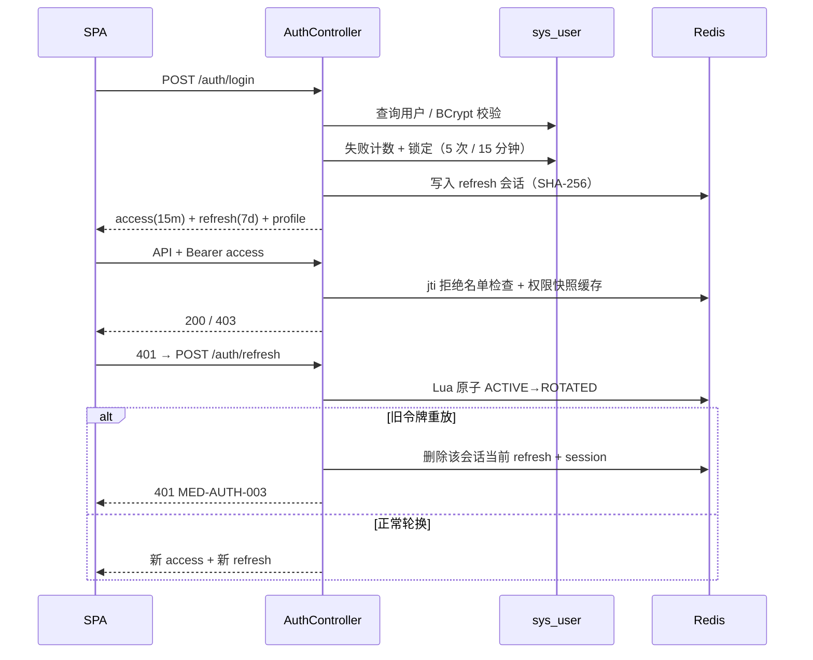

# M1 权限体系 · 实现说明

| 项 | 值 |
| --- | --- |
| 状态 | ✅ 已完成（2026-10-26） |
| 对应需求 | FR-M1-01 ~ FR-M1-11 |
| 后端 | Spring Security 7 + JWT + Redis 刷新令牌 + MyBatis-Plus |
| 前端 | Angular 22 Signals + AuthStore + 单飞刷新拦截器 + 动态菜单 |
| 测试 | 后端 36 个用例（含 Testcontainers）、前端 32 个用例 |

## 1. 交付范围

- 登录 / 刷新 / 登出 / 当前用户与菜单。
- 用户、角色、权限、科室管理；角色授权；审计查询。
- 菜单、按钮、接口三级权限；科室数据范围隔离。
- 登录失败锁定、密码重置吊销会话、权限缓存失效。
- 审计：登录成功/失败、登出、越权、用户/角色/科室变更。

## 2. 演示账号

密码统一为 `Medflow@2026`（BCrypt cost 12）：

| 用户名 | 姓名 | 科室 | 角色 | 数据范围 |
| --- | --- | --- | --- | --- |
| `admin` | 系统管理员 | 行政管理 | ADMIN | ALL |
| `doctor1` | 张明 | 皮肤科 | DOCTOR | DEPT |
| `doctor2` | 李静 | 全科医学科 | DOCTOR | DEPT |
| `nurse1` | 王芳 | 皮肤科 | NURSE | DEPT |
| `pharmacist1` | 赵磊 | 药房 | PHARMACIST | ALL |
| `cashier1` | 陈晨 | 全科医学科 | CASHIER | DEPT |
| `nurse2` | 孙悦 | 皮肤科 | NURSE | DEPT（已停用，用于测试） |
| `nurse3` | 刘敏 | 全科医学科 | NURSE | DEPT（M2 跨科室签到演示） |

> 账号数据来自 `V2__iam.sql`，全部为合成数据。

## 3. API

| 方法 | 路径 | 权限 | 说明 |
| --- | --- | --- | --- |
| POST | `/api/v1/auth/login` | 公开 | 登录，返回 access + refresh |
| POST | `/api/v1/auth/refresh` | 公开 | 刷新令牌一次性轮换 |
| POST | `/api/v1/auth/logout` | 已登录 | jti 拒绝名单 + 吊销刷新令牌 |
| GET | `/api/v1/auth/me` | 已登录 | 用户、角色、权限、菜单、数据范围 |
| GET | `/api/v1/users` | `system:user:read` | 分页查询 |
| POST/PUT | `/api/v1/users`、`/users/{id}` | create/update | 新建/编辑 |
| PATCH | `/api/v1/users/{id}/status` | `system:user:disable` | 启用/停用并解锁 |
| POST | `/api/v1/users/{id}/reset-password` | reset-password | 重置密码并吊销全部会话 |
| GET | `/api/v1/roles` | `system:role:read` | 角色 + 权限 ID |
| POST/PUT | `/api/v1/roles`、`/roles/{id}` | create/update | 角色维护 |
| PUT | `/api/v1/roles/{id}/permissions` | assign-permission | 覆盖式授权 |
| GET | `/api/v1/permissions/tree` | `system:role:read` | 菜单/按钮/接口权限树 |
| GET | `/api/v1/departments` | `system:dept:read` | 科室列表（全角色可读） |
| POST/PUT | `/api/v1/departments` | `system:dept:manage` | 科室维护 |
| GET | `/api/v1/audit-logs` | `system:audit:read` | 审计分页查询 |
| GET | `/api/v1/staff/doctors` | `schedule:read` | 受数据范围约束的医生列表 |

错误统一为 Problem Details；`403` 不泄露资源是否存在，跨科室显式请求返回 `MED-AUTHZ-001`。

## 4. 认证与会话



### Redis Key

| Key | 值 | TTL | 用途 |
| --- | --- | --- | --- |
| `auth:refresh:{sha256}` | `userId\|sessionId\|ACTIVE` 或 `ROTATED` | 7d | 刷新令牌；Lua 原子轮换 |
| `auth:session:{sessionId}` | `userId\|currentHash` | 7d | 会话当前刷新令牌 |
| `auth:user-sessions:{userId}` | Set<sessionId> | 7d | 密码重置 / 停用时批量吊销 |
| `auth:deny:{jti}` | `1` | 剩余有效期 | 登出后的访问令牌拒绝名单 |
| `perm:user:{userId}` | AuthoritySnapshot JSON | 10m | 权限/菜单/数据范围缓存 |

### 关键规则

1. 刷新令牌只存哈希；旧令牌标记 `ROTATED` 保留到 TTL，用于识别重放。
2. 重放检测到后吊销**当前会话**，新令牌一并失效；其他设备会话不受影响。
3. 登出把 `jti` 写入拒绝名单，访问令牌立即失效；刷新令牌同时吊销。
4. 密码重置 / 停用用户会调用 `revokeAll` 吊销该用户全部刷新令牌。
5. 密码 BCrypt cost 12；错误密码不区分"用户不存在"和"密码错误"。

## 5. 权限与菜单

- 权限码统一 `模块:资源:动作`；`MENU/BUTTON/API` 三类共用同一权限码。
- 登录返回的菜单由服务端按角色过滤并构建树；前端不硬编码角色。
- 前端 `permissionGuard` 控制路由，`*appHasPermission` 从 DOM 移除按钮。
- 后端每个写接口带 `@PreAuthorize`；方法级拒绝统一 403 Problem Details。
- 授权变更后 `PrincipalService.evict(userId)`，下一次请求重新加载权限。
- 管理员角色 `ADMIN` 的权限与数据范围受保护，不能通过接口清空或改为 SELF。

### 数据范围

`ALL > DEPT > SELF`，取用户所有角色最大值：

- `ALL`：可查询全院；`DEPT`：只能查询本科室；`SELF`：仅本人。
- `/staff/doctors` 显式传入其他科室 ID 时返回 403，而不是静默空列表。
- 前端工作台展示当前数据范围，避免用户误解。

## 6. 审计

| 动作 | 触发点 | 关键字段 |
| --- | --- | --- |
| `AUTH_LOGIN_SUCCESS/FAILED` | 登录 | 用户名、失败错误码、IP、requestId |
| `AUTH_LOGOUT` | 登出 | 操作人、requestId |
| `ACCESS_DENIED` | 方法级 403 | 用户、请求路径、错误码 |
| `USER_CREATED/UPDATED/STATUS_CHANGED/PASSWORD_RESET` | 用户管理 | 变更前后（不含密码） |
| `ROLE_CREATED/UPDATED/PERMISSION_CHANGED` | 角色管理 | 权限 ID 前后集合 |
| `DEPARTMENT_CREATED/UPDATED` | 科室管理 | 名称/类型/父级 |

- 失败审计使用 `REQUIRES_NEW`，避免外层业务异常回滚审计。
- 审计只追加；不记录密码、令牌、病历正文。
- 查询默认最近 7 天，支持动作与操作人过滤。

## 7. 前端实现

```text
core/auth/
  auth.models.ts        # 登录/用户/菜单类型
  auth.api.ts           # HttpClient
  token-storage.ts      # access 仅内存，refresh 存 localStorage
  auth.store.ts         # Signals + 单飞刷新 + restore
  auth.interceptor.ts   # Bearer + 401 重试
  auth.guards.ts        # authGuard / guestGuard / permissionGuard
core/permissions/
  has-permission.directive.ts
features/auth/          # 登录页（Signal Forms）
features/staff/         # 科室人员（验证数据范围）
features/admin/*        # 用户 / 角色 / 科室 / 审计
```

设计取舍：

- Access Token 只放内存，降低 XSS 持久化风险；刷新令牌放 localStorage 以支持刷新页面恢复会话。
- 刷新请求用 `shareReplay` 单飞，3 个并发 401 只触发一次 `/auth/refresh`。
- 登录表单使用 Signal Forms；后台多选角色使用原生复选框 + 手动校验，避免 Material 多选与 Signal Forms 的兼容性风险。
- 菜单完全由后端返回；前端仅做图标映射与分组展示。

## 8. 验证证据

| 验证 | 命令 | 结果 |
| --- | --- | --- |
| 后端全量 | `cd backend && ./mvnw verify` | 36 个用例通过（Testcontainers MySQL 8.4 / Redis 8） |
| 认证流程 | `AuthFlowTest` | 8/8：登录、角色菜单、锁定、刷新轮换、重放、登出、缺失令牌 |
| RBAC/范围 | `RbacScopeTest` | 6/6：本科室、跨科室 403、管理员无临床权限、权限树 |
| 管理后台 | `IamAdminTest` | 7/7：建科室/角色/用户、缓存失效、停用/重置密码、审计、越权审计 |
| 库表与种子 | `IamSchemaTest` | 6/6：V2、5 角色、权限、BCrypt、锁定列 |
| 前端 | `pnpm --filter medflow-web test` | 32 个用例通过 |
| 构建 | `pnpm --filter medflow-web build` | 成功 |

手工 API 验证（本地 Compose）：

```bash
# 管理员登录 → 菜单包含系统管理
curl -s -X POST http://localhost:8080/api/v1/auth/login \
  -H 'Content-Type: application/json' \
  -d '{"username":"admin","password":"Medflow@2026"}'

# 医生登录 → 菜单仅工作台 / 科室人员 / 科室管理
# 医生访问 /api/v1/users → 403 MED-AUTHZ-001
# 医生 /api/v1/staff/doctors → 只返回皮肤科张明
# 管理员 /api/v1/audit-logs → 可见 AUTH_LOGIN_SUCCESS / ACCESS_DENIED
```

## 9. 已知边界

- 未实现短信/微信二次认证、密码找回、多设备会话管理界面。
- 登录锁定基于数据库 `locked_until`；未提供独立的"解锁"按钮，管理员通过启用/停用或等待 15 分钟解锁。
- `system:dept:read` 按需求矩阵授予所有角色，因此非管理员可在菜单看到只读的"科室管理"。
- 权限缓存 TTL 10 分钟，但授权/用户变更会主动失效；若 Redis 不可用，权限读取会回源数据库（缓存组件捕获异常）。
- 未实现审计日志导出与归档。

## 10. 下一步（M2）

`doctor_schedule` / `schedule_slot` / `appointment` / `charge_order` / `refund_record` 迁移与并发预约；复用 M1 的 JWT、权限注解、数据范围与审计基础设施。
